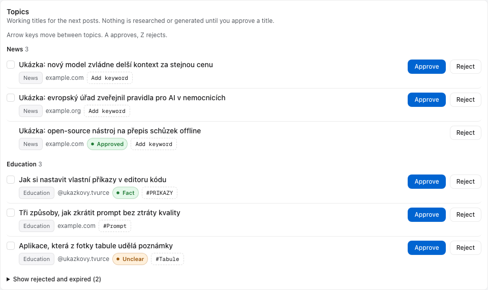
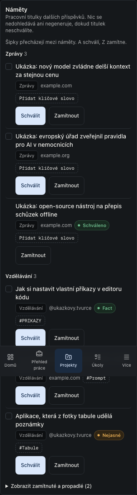

# OwnDashboard visual QA

> Template-picker update (2026-10-26, finding 307): sixty affected EN/CS desktop/mobile cases pass. Sixteen final picker cases pass after visual inspection catches and repairs desktop preview clipping. The complete 10,000-template library remains searchable while only fifty saved choices and three built-ins mount; focus, refusal, fallback/empty states, six widths and axe are checked without extra reads. The wider audit/release remains unfinished.

> Career history update (2026-10-26, finding 305): twenty-eight final EN/CS desktop/mobile native cases pass. Complete history and 1,201 previous letters remain reachable through fifty-record local pages, with no extra reads. The narrow sidebar fits its content and stacks the pager with a single-line range. Keyboard, disclosure state, reuse/dirty exits, six widths and axe are included; wider release work remains open.

> Career row update (2026-10-26, finding 304): twenty EN/CS desktop/mobile native cases pass. Unsupported destinations remain text, long rows wrap, controls match at 44px mobile/32px desktop and the manual source label is localized. Six-width reflow, axe, board move/focus and letter/removal recovery are included. Final app-wide release remains unfinished.

> Letter-workspace update (2026-10-26, finding 303): forty affected EN/CS desktop/mobile native cases pass. Workspace context protects navigation, a pending older template receipt retains newer context and corrected invalid text unlocks saving. Earlier application/template recovery, axe and reflow checks are included. The visual plan retains its dated authentic captures; this behavior change adds no invented UI.

> Oslo letter update (2026-10-26, finding 302): seventeen native cases pass with one configured skip across EN/CS desktop/mobile. Retained draft/retry, explicit reload, navigation save and confirmed application handoff are checked; the existing six-width/two-theme and axe matrix also passes. Ordinary previews remain isolated from private writes. This is targeted evidence, with the wider audit/release unfinished.

> Career draft update (2026-10-26, finding 301): all 48 affected EN/CS desktop/mobile cases pass, including inline template retries, both-draft navigation saves and confirmed application recording with an unsaved template. Earlier six-width, axe and recovery checks remain in that run. These isolated checks do not complete the wider release audit.

> Career template manager update (2026-10-26, finding 300): sixteen native cases pass across EN/CS and desktop/mobile. Captured edits, stable creation retries, retained conflict/reload drafts, pending exits, confirmed removal/focus, local paging and mobile targets are checked; the editor also passes six widths and axe. These are synthetic preview checks, not a final app-wide release.

> Career board (2026-10-26, finding 278): nineteen final native cases pass with one configured duplicate skip in 1.6 minutes. Each stage pages ten complete local records, keeps full counts and equal widths, excludes already-recorded saved cards, and reveals/focuses only the appropriate confirmed move. Failed moves restore the original control; mobile stage/drag targets reach 44px. Six-width reflow and axe pass. Four final capture cases pass in 19.3 seconds with a tall real viewport; the visual plan records the authentic paired board images and exact code hashes. Captured progress-write ownership/version controls remain separate.

> Career availability (2026-10-25, finding 277): sixteen final EN/CS desktop/mobile cases pass in 1.9 minutes. The real interface rejects a foreign-owner result, starts one check after activation, retains failed next-window progress and confirms an explicit retry. Its recovery panel stays within 768px at six widths; axe passes. The 1,201-row local paging cases remain covered. Synthetic replies stand in for public page checks; no owner record, paid provider or publication is used. Broader audit and release work continues.

> Career collections (2026-10-25, finding 274): eighteen final native EN/CS desktop/mobile cases pass in 53.3 seconds. Complete 1,201-row offers, saved positions and application lists render fifty rows per page, search the final record and reset pages without more database/provider calls. Initial Career access makes no private collection read; application totals retain the full cohort. Six-width reflow, axe and existing recovery checks pass on isolated synthetic data. Board paging, remaining write/provider review and the final app-wide release stay open.

> Client field feedback (2026-10-25, finding 224): thirty-four native EN/CS desktop/mobile cases pass in 1.2 minutes. Invalid fields have localized linked guidance after blur, empty optional fields remain valid and uppercase HTTP(S) matches native admission. All four invalid-submit timeouts from checkpoint 85 pass in this targeted run; the earlier full run remains failed (729 pass, 99 skip, four fail). Captured saves, six-width/axe recovery, long details and ordinary preview remain covered. No production data changes.

> Visual-plan checkpoint (2026-10-25): twenty-four actual desktop/mobile component pairs now include client refresh recovery and retained/discardable client forms from `5d7da1d`. All 48 mode/image loads, 390px/1440px light/dark reflow, highlight toggles and mapped coordinates pass with no artifact page errors. Older captures retain their own source labels. These are synthetic preview captures, not owner records or a production rollout.

> Client notice refinement (2026-10-25, finding 222): four filtered native cases pass recovery/reflow in 11.6 seconds, but did not execute the new stacking assertion because it was placed in the wrong test. After checkpoint 84 catches that error, all fourteen affected EN/CS desktop/mobile cases pass in 40.3 seconds, including actual full-width mobile stacking, 44px targets, six widths, axe and recovery. Actual crops use synthetic data and a tall mobile viewport; no fixed navigation is hidden.

> Client recovery (2026-10-25, finding 220): twenty-two final native EN/CS desktop/mobile cases pass in 53.1 seconds. Cached-read failure retains clients with one retry; long contact/details fit six widths; unsupported saved URL schemes stay inert; confirmed deletion restores keyboard focus. Axe and captured persistence/read recovery pass. These fixture checks include intentional 503 responses and do not establish production rollout or final app-wide release.

> Client persistence (2026-10-25, finding 219): eighteen final native EN/CS desktop/mobile cases pass in 40.6 seconds, including failed saves with retained identity, guarded pending exits, visible closed-row conflicts, explicit reload, confirmed VAT updates, complete-read recovery, six-width reflow and axe. Synthetic 503 responses are intentional. The real client form keeps its centered maximum width and mobile targets. These isolated fixture checks do not establish production rollout or replace the final app-wide release.

> Daily mix recovery (2026-10-24, app-wide finding 145): twelve final fixture browser cases pass in EN/CS on desktop/mobile, including pending/failed saves, guarded exits, version conflicts and explicit reload. Six-width geometry, native control heights, axe, console and the unchanged offline preview pass. Actual Czech conflict layouts were inspected: desktop controls share one row, mobile retains full labels and recovery copy. This is targeted evidence; the app-wide optimized matrix and production rollout remain pending.

> App-wide review checkpoint (2026-10-24): [findings 78–85](../reports/app-wide-audit-2026-10-23/review.md) cover connection-status recovery, versioned OAuth removal and confirmed sign-out. The targeted runs pass 32 distinct desktop/mobile browser cases, including all 25 visible destinations at six widths, EN/CS/theme samples, command-palette focus, unsaved-draft/history recovery, login and tour isolation. Four final tour checks include blocked command-palette logout. Six duplicate-project matrix cases are intentionally skipped. Component checks exercise localized logout retry and the draft guard before any server action. These are fixture checks, not a real owner logout or final app-wide release; remaining source and optimized release review continues.

> Implementation update (2026-10-23): [the audit implementation report](../reports/dneskai-audit-implementation-2026-10-23.md) records completed changes and exact release checks (2,779 unit/integration passes, one existing skip; 247 browser passes, 79 project-specific skips). [Actual before/after captures](../reports/dneskai-code-ux-audit-2026-10-23/implementation.html) are separate from the original proposed treatments. The new fixture matrix covers all 25 visible destinations at six widths; hidden Inbox/References retain their URL-only policy. Keyboard/focus, axe, EN/CS/theme samples, failed-save recovery, install metadata and the one-page dark-mode A4 invoice passed. Browser tests use isolated Chromium because the signed-in Chrome extension was unavailable. Manual screen-reader and actual browser zoom checks remain unrun; Production is unchanged.

> Review update (2026-10-23): the [DNESKAi and application UX audit](../reports/dneskai-code-ux-audit-2026-10-23/README.md) adds current fixture screenshots, DOM measurements, code findings and a visual implementation plan against `d6f60c7`. Its [validation record](../reports/dneskai-code-ux-audit-2026-10-23/validation.md) distinguishes checks run from follow-up work. This was a review, not a new UI release or a full WCAG/A4 certification; the historical results below retain their original date.

Date: 2026-07-27

> Note (2026-07-29, commit `268062b`): the natural-language Quick Add control and its mobile fixed-position button were removed. The "mobile Quick Add clearance" checks and the "Quick Add control positioned above [safe-area navigation]" constraint referenced below no longer apply. The remainder of this report reflects the state on 2026-07-27.

> Note (2026-07-29, commit `5d32e6b`): the Agents task queue and every model-backed AI surface were removed. The Agents checks in the coverage list, the workflow table and the results no longer apply.

Scope: private sign-in, macOS-native authenticated shell, core professional workflows, project workspace, semantic design system, responsive navigation, accessibility states, and deferred-media seams.

## Method

`/dev-preview` remains the canonical fixture-only visual harness and returns 404 in ordinary production builds. Playwright sets the server-only `NEXT_E2E=1` flag on its local production build so the same optimized server can expose fixtures during tests. The suite checks 360, 430, 768, 1024, 1440, and 1728 px. The matrix includes Czech at 360 px, dark mode at 1024 px, desktop/mobile navigation changes, horizontal overflow, the mobile Quick Add clearance, and access to every destination through the mobile More sheet.

The test suite also covers:

- keyboard-reachable canonical navigation and stale-preference repair;
- the project workspace and its horizontal tab model;
- login and OAuth callback errors;
- removed personal destinations;
- mobile destination-sheet semantics;
- the width-contained mobile Career table and its sortable columns;
- subscription grouping, importance, next-payment dates, and renewal countdowns;
- the project communication timeline and VPS Agents task queue;
- Home daily focus with seven deterministic items, GLOBAL priority, waiting age, regeneration, completion garden, and active-project navigation links;
- Career selection semantics and owner-scoped permanent deletion controls;
- application-styled destructive confirmation surfaces;
- axe scans for serious or critical WCAG A/AA violations;
- a dark-mode Czech invoice rendered to a parsed, single-page A4 PDF.

## Implementation review

The code review and static checks confirmed these design constraints:

- one canonical sidebar/mobile/shortcut/command-palette navigation model;
- a viewport-contained graphite desktop and an app window inset 20 px vertically and 30 px horizontally, three window controls, 224 px translucent sidebar, and 52 px toolbar;
- a five-destination mobile hierarchy with all remaining areas in an accessible dialog;
- safe-area-aware fixed navigation and a Quick Add control positioned above it;
- semantic light/dark tokens for surfaces, statuses, charts, focus, and AI evidence;
- tabular figures for money, dates, rates, and counts;
- compact 12 px modules, 22 px section-identity title tiles, 32 px KPI icon tiles, and 12–12.5 px data tables;
- primary Projects and Career tables fit the 13-inch desktop content width before horizontal scrolling;
- task titles wrap to three lines and dynamic Task/Link groups use masonry rather than forced equal-height rows;
- every production badge/tag uses at least 3 px vertical and 7 px horizontal padding;
- gradients are confined to the graphite desktop and primary button; there are no sparkles, floating glass panels, generated UI, or decorative finance media;
- generated-media slots do not request missing files;
- reduced-motion behavior remains active through CSS and the shared Motion configuration;
- printed invoices retain fixed paper colors and print isolation.

## Automated coverage added

| Area | Assertion |
| --- | --- |
| Responsive matrix | No document-level overflow at all six required widths |
| Navigation | Desktop sidebar and mobile bottom navigation switch at the defined breakpoint |
| macOS shell | Desktop Home exposes the contained app window, shared toolbar, and exactly three traffic-light controls |
| Mobile hierarchy | More opens an accessible destination dialog and navigates to Opportunities |
| Career table | Match/Remote/Location remain semantic and the wide table scrolls without widening the mobile page |
| Operational workflows | Project Communication, the Agents queue, and subscription grouping/renewals render from deterministic fixtures |
| Daily focus | Seven active/GLOBAL tasks from the canonical Tasks source, priority order, waiting age, regeneration, garden, and active-project navigation render from deterministic fixtures |
| Project navigation | Active-project links open inside the persistent shell; the Projects parent returns to the full table and browser history preserves the selected context |
| Preference persistence | Navigation visibility and project-workspace tab visibility survive reload in the deterministic client cache; database persistence is covered by own-only migration contract tests |
| Confirmation dialog | Destructive confirmation uses an opacity-only entry and remains centered without a first-frame position shift |
| Fixed controls | Quick Add does not overlap the mobile navigation |
| Localization | Narrowest matrix case renders Czech fixtures |
| Theme | 1024 px matrix case renders dark mode |
| Accessibility | The open mobile destination dialog is included in axe coverage |
| Auth failure | OAuth callback errors expose an alert with an actionable explanation |

## Runtime result

The final `npm run test:e2e` run completed against the optimized local Next.js server: **47 passed, 35 intentionally skipped by project, 0 failed** across the desktop and mobile projects. The skips avoid duplicating desktop-only coverage in the mobile project and vice versa; no required assertion was disabled to obtain the result.

Verified runtime evidence:

- the responsive matrix completed without document-level overflow at all six required widths;
- Czech rendered at 360 px, dark mode rendered at 1024 px, and the remaining matrix cases rendered in English/light mode;
- desktop sidebar, mobile navigation, mobile More dialog, and fixed Quick Add clearance passed;
- login plus 17 representative authenticated destinations passed axe with no serious or critical WCAG A/AA violations;
- the open mobile destination dialog passed axe and remained keyboard/semantics reachable;
- all 23 canonical destinations (22 sidebar areas plus Settings) opened without console errors;
- Career sorting, mobile table containment, project Communication, the Agents queue, and subscription group/importance/countdown presentation passed their workflow assertions;
- Home rendered the deterministic seven-task focus at desktop and mobile widths, including GLOBAL, waiting-age, garden, regeneration, and active-project navigation assertions;
- project links stayed inside the shell, the Projects parent restored the full table, navigation/project-tab choices survived a new page load, project tasks grouped correctly, and the destructive confirmation stayed centered from its first frame;
- the manifest, dynamic PNG icon, and maskable icon declaration passed;
- a dark-mode Czech invoice remained white, retained print isolation, generated a PDF larger than 10 KB, parsed successfully, and occupied exactly one A4 page;
- the rendered invoice was visually inspected after the print-spacing correction; the earlier footer-only second page no longer exists.

The suite intentionally uses a production-backed fixture server because cold development compilation was nondeterministic under shared host load. Per-test assertions remain capped at 90 seconds; only the one-time build/server setup receives a longer window.

## Media QA

No generated artwork was produced. There are therefore no shipped files to inspect for text artifacts, watermarks, third-party marks, crop failures, motion, or file-size budgets. The manifest records prompts, intended placements, provider-selection gates, and accessibility classifications without production references. After a researched low-cost/free provider produces reviewed assets, extend this record with provider/model provenance, license and pricing sources, real dimensions, sizes, light/dark/mobile crops, reduced-motion fallback, and contextual screenshots.

## Rerun

1. Run `npm run test:e2e`; Playwright builds once and owns the optimized fixture server.
2. Inspect failures at each encoded width instead of weakening assertions or updating snapshots blindly.
3. Capture authentic `/dev-preview` screenshots only after functional assertions and axe pass.
4. Recheck both languages, both themes, long labels and values, zoom/reflow, focus order, dialog escape/focus return, and invoice print preview whenever shared layout or typography changes.
5. Keep `NEXT_E2E` confined to local/CI test processes. Never configure it in a deployed environment.

## Career application pipeline — 2026-09-11

The Career change adds a prepared-application list with posting and Google Drive links, a sent transition, response/follow-up editing, and cohort statistics. Only fictitious fixture records are used in preview screenshots; imported company research and real letters remain in the owner's database and Drive.

Visual review found that a horizontal action group at 1024 px squeezed the role title into a narrow column even though the page passed the overflow check. Prepared rows now keep their actions below the company and role at every width. Small positive-fit badges and matched-skill chips use the foreground text token to fix the contrast violations found by axe.

The new E2E coverage exercises both document links, the manual sent transition and its stable request ID, response entry and the resulting response rate, plus Czech prepared rows at 360, 430, 768, 1024, 1440 and 1728 px. The 1024 px case uses dark mode. Existing navigation tests were updated to reflect the already-removed Agents destination and Quick Add control, and mobile heading assertions are scoped to the shell header.

The test backend returns the persisted application after each mutation so cache invalidation can be checked through a realistic read-after-write flow. Database rollback checks separately cover the real RPC, retry idempotency, history and ownership; the preview does not verify a signed-in production session or Google account permissions.

No new media was generated. Broader manual zoom/keyboard audits and every disconnected/error state were not repeated for this feature; the existing automated navigation, accessibility, responsive, PWA and invoice suites remain the release checks.

The completed full run recorded 45 passes, 33 intentional project skips and two failures in existing tests: external Google favicon requests failed, and the mobile posting-detail test still expected the former “Prepare application” action. The fixture harness now serves a local transparent favicon response, and the detail assertion checks the current “Save position” action. The two affected checks are rerun separately after those test-only corrections.

All new Career checks passed in the full run, including the desktop/mobile sent-and-response flow and the six-width Czech/axe matrix. Authentic screenshots of the prepared rows, the corrected 1024 px dark layout and the desktop/mobile response statistics were visually inspected.

Final verification: `npm run lint` and `npx tsc --noEmit` passed; `npm run test` passed all 276 tests in 30 files; the production build passed. `npm run test:e2e -- --last-failed` then passed both corrected checks. Across the full run and that targeted rerun, all 47 executed E2E checks passed, with 33 deliberate desktop/mobile project skips and no unresolved failure. The entire suite was not repeated after these two test-only corrections.
## Freelance opportunities — 2026-09-11

The platform directory and proposal editor were checked in the deterministic public preview at 360, 430, 768, 1024, 1440 and 1728 px, including Czech, English and a dark 1024 px case. Checks cover opening each editor, profile text, document/source fields, date-order feedback, dialog accessibility and horizontal overflow. Mobile platform rows and the dark profile dialog were visually inspected. Owner profiles, proposals and Drive URLs are excluded from preview fixtures and screenshots.

`npm run lint`, `npx tsc --noEmit`, all 278 unit tests in 31 files, and the production `npm run build` passed. The full E2E run recorded 47 passes, 34 intentional skips and one failure because the new English dialog test matched both Close buttons. Its selector was scoped to the first match, and the targeted six-width check passed; it passed again after the aggregate metrics and resource links were added. Across the full run and targeted repair, all 48 executed checks passed. The full suite was not repeated after that correction.

Live database checks used owner and unrelated authenticated claims to verify RLS, absence of client event-write grants, the history trigger in a rolled-back transaction, and full-cohort metrics with zero submissions. Browser preview does not verify a signed-in production session or external account creation. No new media was generated.

## Resource library — 2026-09-11

The Links change was checked with synthetic preview records at 360, 430, 768, 1024, 1440 and 1728 px, including Czech, English and a dark 1024 px case. Collapsed cards expose name, domain, pricing dot and edit/delete actions; keyboard disclosure, pricing filters, empty search, clear filters and both dialogs passed. The revised matrix also checks expanded multi-paragraph content and a long source URL, with axe scans and horizontal-overflow assertions.

Visual inspection of all six initial widths found that the sidebar left too little room for two columns at 768 px, despite passing overflow checks. The second column now starts at 1024 px, and the targeted six-width matrix passed again. The corrected tablet view and expanded mobile/dark views were inspected. Favicons use a deterministic transparent fixture response, so these screenshots do not test third-party logo availability; production retains an initial fallback on image failure. No owner records or research imports appear in preview screenshots, and no new media was generated.

`npm run lint`, `npx tsc --noEmit`, `npm run test` (280 tests in 32 files) and the ordinary production `npm run build` passed. The full `npm run test:e2e` run passed 49 checks with 35 intentional project skips; after the tablet breakpoint and longer fixture were added, `npm run test:e2e -- e2e/link-library.spec.ts` passed the six-width check with one intentional mobile-project skip. The whole E2E suite was not repeated after that bounded layout correction. An intermediate lint invocation raced with Playwright clearing its output directory and failed with ENOENT; the final lint run completed successfully after the browser run.

Read-only authenticated database transactions verified that the owner can read 119 links and 19 categories, while unrelated claims read zero of either. All 36 new entries have dated source notes and all category references belong to the owner. The existing own-only policies remain enabled. These checks verify stored data and fixture behavior, not a signed-in production browser session or subscription entitlements on third-party sites. Pricing remains a dated manual assessment, and three older entries retain an explicit unverified marker.

## Links / Ideas review and export — 2026-09-15

The new UI uses the existing `/dev-preview` shell, semantic components and deterministic fixtures. No generated media was added.

- `npm run test`: 28 files, 259 tests passed, including four export/legacy-description tests.
- `npm run lint`: passed. Generated Playwright reports and test artifacts are now excluded from source linting.
- `npx tsc --noEmit`: passed after using the same Axe/Playwright type bridge as the existing accessibility suite (the lockfile contains two Playwright core versions).
- `npm run build`: passed; the targeted browser run also rebuilt the production-backed fixture server.
- Full `npm run test:e2e`: 45 passed, 33 skipped, 4 failed. Three failures waited for the removed Agents navigation; one expected the absent mobile Quick Add button. These tests and the corresponding shell were unchanged in this feature diff. A clean-baseline browser rerun was not performed, so these are not claimed as experimentally proven baseline failures. They remain release-suite limitations.
- Targeted `npm run test:e2e -- e2e/link-export.spec.ts`: 8 passed. Idea creation used a mocked authenticated backend, verified `record_type=idea`, placement below Links, rating, expandable relevance and source links. Targeted export checks passed on desktop and mobile: exact pricing selection, JSON/Markdown preview, copied content, download filename, clipboard denial with manual fallback, Escape and trigger focus return, and zero axe violations in the dialog.
- Czech dark-mode export passed overflow checks at 360, 430, 768, 1024, 1440 and 1728 px. The captured authentic 1728 px dialog screenshot was visually inspected: readable controls, contained preview and visible actions.
- The existing full suite also passed its responsive-width matrix and Czech A4 invoice checks. No changes were made to invoice or shared navigation behavior.
- Live database probes ran with the authenticated role and rolled back: non-owner reads returned no rows, spoofed-owner writes and unowned-category writes were rejected, and owner reads returned all 174 imported records.

Private research evidence, exports and per-post coverage remain outside Git under `.claude/observations/reel-research/`. Production sign-in and a deployed Ideas/export interface were not tested; this task did not deploy application code.

## Main integration — 2026-09-16

Integrated the Ideas/export feature with main's newer searchable expandable resource cards. Both sections share pricing/category/search filters, sorting and expand/collapse controls; card details retain ratings, rationale, repository relevance and sources. Existing Career work remains intact.

- Lint and TypeScript passed; 33 unit-test files / 284 tests passed.
- Combined library/export browser checks: 9 passed, 1 intentionally skipped duplicate mobile matrix. Covered six widths, EN/CS, keyboard controls, axe, Idea creation, export pricing/copy/download and clipboard denial.
- Updated selectors for the combined search label, expandable Idea cards and distinct source links. The initial selector failures were corrected before the passing run.
- A local dependency symlink was rejected by Turbopack; a local dependency copy resolved setup. Both the E2E production build and ordinary production build passed.
- Previous full-suite limitations remain documented above; the full suite was not rerun for this integration.
- User explicitly authorized a main push and redeployment in the follow-up.

## Focused taxonomy and export controls — 2026-09-16

Links and Ideas now use separate export dialogs. The targeted browser suite covered all-record, selected-category and individual-record selection; free, combined free/freemium and exact price filters; detailed, compact and category-grouped JSON; Markdown; clipboard and download; clipboard denial; Escape/focus return; and dialog axe scans. Ideas render their goal as the row label and expose the observed Reel subject, benefit, project relevance and original source after expansion.

- `npm run lint`: passed.
- `npx tsc --noEmit`: passed.
- `npm run test`: 33 files, 286 tests passed.
- `npm run build`: passed.
- `npx playwright test e2e/link-export.spec.ts`: 8 passed across desktop and mobile.
- The Czech dark export dialog passed document-overflow checks at 360, 430, 768, 1024, 1440 and 1728 px with no axe violations.
- The live owner collection contains 171 links and 17 ideas in 37 link categories and 10 idea categories, with no uncategorized records. The code test harness continues to use synthetic fixtures rather than owner data.

## Career stage board — 2026-09-17

Applied gained a board layout beside its list, and the follow-up date it shows
now also appears on the Work overview and in the Home hero.

- `npx tsc --noEmit`: passed.
- `npm run lint`: passed.
- `npm run test`: 45 files, 505 tests passed, including the new
  `tests/lib/jobs-board.test.ts`.
- `npm run build` and `npm run test:e2e` were **not run in this session** — they
  are executed centrally for this change. `e2e/career-board.spec.ts` is written
  and covers the five column headings and their counts, the saved column's
  review button, the due follow-up cue, the payload a stage change posts, plus
  a Czech width matrix at 360, 430, 768, 1024, 1440 and 1728 px with
  document-overflow and axe `wcag2a`/`wcag2aa`/`wcag21aa` scans. Its screenshots
  and axe results are therefore not yet recorded here; this entry will be
  incomplete until that run reports.
- Design decisions made without a browser: the board is the only horizontal
  scroller on the page and is labelled and focusable, each column is a heading
  rather than a landmark so the board does not bury the page's real ones, and
  the overdue follow-up carries the word "due" as well as the warning tone.

## IG TIPS, detected Tools and the Own/Freelance switch — 2026-09-26

IG TIPS left Links for its own Library section, Tools lists what the active
projects' repositories use, and Settings gives each active project an Own or
Freelance control.

- `npm run lint`, `npx tsc --noEmit` and `npm run build`: exit 0 on the final
  commit. `npm run test`: 60 files, 654 tests, exit 0. Every commit of the
  branch also passed `tsc` and the unit tests on its own.
- `npm run test:e2e`, full suite on the commit before the paged detected list:
  162 tests, 97 passed and 65 skipped by project design, exit 0 in 4.6 minutes.
  The web server logged two `getaddrinfo ENOTFOUND example.supabase.co` errors
  from server-side session checks with the fixture cookie; no test failed.
  After the paged list, `e2e/tools.spec.ts`, `e2e/a11y.spec.ts` and
  `e2e/ig-tips.spec.ts` ran again: 34 passed, 24 skipped, exit 0.
- New browser coverage: IG TIPS topic sections, icon-free cards, keyboard
  details, topic chips, search, the tip export, adding and editing a tip, a link
  moved out of Links, and Czech at 360 px with 44 px card actions and no axe
  violations; Tools detected rows, the repository statuses and the project and
  text filters; the Own/Freelance switch both ways, a failed write, and Czech at
  360 px with axe.
- `/dev-preview` captures at 360 px and 1440 px in English light (IG TIPS, the
  detected Tools list, Settings → Active projects, Links, Projects) and at 360 px
  in Czech dark (IG TIPS, Settings) showed no horizontal overflow and no page
  errors. They stay outside Git; the three changelog captures in
  `media/changelog/` are committed.
- Limits: the stack parser was checked against the current `about-project.md`
  and `package.json` of the four public active repositories (75 distinct tools).
  Three active repositories are private and could not be read from the agent
  session, and the live route has not run against GitHub, because the preview
  uses fixtures. Nothing was deployed.

## 28 September 2026 maintenance

Existing components and tokens retained. Production-build fixture checks covered desktop/mobile navigation, accessibility and IG TIPS editing. A tip can return to Links via the labelled Type control. Full suite: 105 passes, 70 layout-specific skips, three fixture/interaction failures corrected; affected-suite rerun: 24 passes, 12 skips. No new generated media.

## Oslo Career and shared Apple-style interface — 16 October 2026

Production-code preview, with fictional private records, reviewed at 360, 430, 768, 1024, 1440 and 1728 px. The Oslo matrix covers Czech/light and English/dark at every width; existing Czech pipeline matrices also cover dark at 1024. No horizontal document overflow or axe WCAG 2.0/2.1 A/AA violations in the final run. Desktop and mobile screenshots were inspected. The shared sidebar, toolbar, cards, controls, typography and dialogs affect all product areas; existing navigation, data-loading, finance, project, editor, PWA and invoice checks remain covered.

Final automated results: `npm run lint` passed; `npx tsc --noEmit` passed; `npm run test` passed (142 files / 1,406 tests, one intentionally skipped test); `CI=1 npm run test:e2e` passed (131 tests, 71 expected viewport/capture skips, no failures or retries). The e2e setup compiles production code with the fixture-only `NEXT_E2E` guard. The ordinary `npm run build` also passed; the last build is recorded separately in the release handoff. The desktop invoice test verifies a white, isolated one-page A4 PDF in dark mode, including the QR.

Career checks cover public research without eager private/scraper requests; the 14-match / 33-role grid; full role/score/gap details; private-letter loading boundaries; English draft fields; unsaved-edit discard/keep; focus returning to the invoking card; the Czech checkbox OFF default and archive restoration; text-only readiness; sent snapshots, response history and stage updates. Manual Chrome checks with normal motion confirmed the TypeSafe AI evidence, no overflow, Escape focus return, empty-search recovery and unknown-availability feedback. Preview never exposes actual private letters.

Repairs driven by testing: page actions now wrap before wide-desktop sizing; selected-sidebar and dark primary-action contrast were corrected; Tailwind 4 owns modal centering (entry keyframes only add relative scale/offset); outgoing pages unmount immediately so duplicate headings/status/live regions cannot survive during navigation. Whole-page initial fades were removed to avoid transient low-contrast text, including under reduced motion. Unsaved counts are shown as unknown until private data loads. No generated imagery or fake product screens were introduced.

Private deployment data checks: the preference migration version matches production history; RLS remains enabled on saved positions, preferences, applications and companies, with four owner-scoped saved-position policies. Thirty-three new private English drafts exist; all twelve prior saved rows were compared field-for-field with their backup and remain unchanged. The shared English CV link is configured and Czech Career is false. No employer applications were submitted. Browser fixture RPC tests cover sending; a live production write round-trip is not claimed by these checks.

Ordinary release build (without `NEXT_E2E`) passed again after the final code edits: compilation 14.3 s, TypeScript 18.5 s. A production-server smoke check returned login 200, Career redirect 307 to login, fixture preview 404, and the research-check API 401 without authentication (cross-origin/missing-Origin attempts returned 403). The final lint and explicit TypeScript checks passed.

## DNESKAi Design Lab continuation — 22 October 2026

The review tab opens a queue/stage/inspector prototype with Editorial only. Authentic full-size synthetic renders are generated by the vendored studio; no source photograph or production record appears in QA. The preview's fixture-only renderer produces new bytes after an edit and remains disabled in ordinary production.

Eight Playwright checks passed across desktop/mobile and EN/CS, with light/dark themes, reduced motion, fit feedback, dirty-state navigation, saving/re-rendering, approval and batch results. The two language flows in each viewport include axe WCAG 2.2 AA scans, no horizontal document overflow, no console errors and no live marketing API requests. Six additional checks passed at widths 360, 430, 768, 1024, 1440 and 1728 px, including the pixel scroll region and selected-slide reload. Desktop and phone screenshots were inspected. An initial duplicate React key in the profile grid was fixed and the eight flows rerun cleanly. The width test clicks the visible view label rather than the visually hidden radio input.

Existing List review tests remain reachable through the explicit List control. No unrelated invoice print, account permission rollout, live publication or notification was exercised by these focused checks. Complete application regression and integration gate outcomes belong to the handoff log; they are not implied by the focused results above.

The integrated release check also covers the public `/guest` Lab as read-only in both browser projects, with no fixture-render or marketing API request. Legacy Sources-to-review tests now expect the Lab; legacy card-editor tests explicitly select List after returning from other tabs. Their navigation and responsive/axe coverage remain intact. A missing-asset demo save now invokes the real fixture renderer even when the deck is unchanged; a dedicated offline regression checks its full-size output. Final browser remediation totals are recorded in LOG.md.

## Project workspace without its header — 22 October 2026 (#171)

Every project workspace now opens on its tab row. The back button „Všechny projekty“, the eyebrow, the summary and the status badge are gone for every project; the toolbar breadcrumb „Projekty › <project>“ carries the context, and its „Projekty“ title is a button that returns to the table (Enter or click). The development and live links moved into the Overview summary card.

`/dev-preview` screenshots of DNESKAi (For review today) and devShark (Overview) were taken and inspected in CS and EN, light and dark, at 1440 px desktop and Pixel 5 mobile: no header above the tabs, no horizontal overflow, breadcrumb legible in both themes. `e2e/dashboard.spec.ts` (desktop and mobile) passed 28/28 together with the screenshot run; it checks that only the toolbar `h1` remains, that „All projects“ is gone on DNESKAi and devShark, and that the breadcrumb button returns to `/projects` from the keyboard.

## DNESKAi state tints and short dates — 22 October 2026 (#173)

Lab queue cards and Příspěvky cards show a post's state as their background (soft token over the opaque surface) instead of a chip; the state words stay in each card's accessible name and tooltip.

Contrast (WCAG 2.2 AA, computed from the tokens in `globals.css`; the tint sits on `--surface`, so the page background behind the card does not change it):

| Text on tint | Light: success / information / warning / risk / muted | Dark: success / information / warning / risk / muted |
|---|---|---|
| `--foreground` | 15.18 / 14.57 / 15.02 / 14.29 / 14.52 | 13.24 / 12.56 / 13.15 / 13.72 / 13.68 |
| `--foreground-muted` | 6.26 / 6.00 / 6.19 / 5.89 / 5.98 | 7.11 / 6.74 / 7.06 / 7.37 / 7.35 |
| `--foreground-muted`, `prefers-contrast: more` | 10.48 / 10.06 / 10.37 / 9.86 / 10.02 | 11.17 / 10.59 / 11.09 / 11.57 / 11.54 |
| `--warning` (deadline note) | 5.15 / 4.94 / 5.09 / 4.85 / 4.92 | 7.51 / 7.12 / 7.46 / 7.78 / 7.76 |
| `--information` (Instagram link) | 5.06 / 4.85 / 5.01 / 4.76 / 4.84 | 7.04 / 6.68 / 6.99 / 7.29 / 7.28 |
| `--risk` (error code) | 5.97 / 5.73 / 5.91 / 5.62 / 5.71 | 5.91 / 5.60 / 5.87 / 6.12 / 6.10 |

Every pair passes 4.5:1. A translucent tint laid straight on the page background (`#f3f4f6`) would have dropped `--success` text to 4.20:1, which is why the tint utilities paint `--surface` first. Axe (wcag2a–wcag22aa) passes on the Lab in English/light and Czech/dark and on Příspěvky in both, at desktop and Pixel 5 widths. Dates read `DD/MM` (`formatDneskaiDay`) in both languages. The macOS baselines in `e2e/dneskai-lab-visual.spec.ts-snapshots/` were regenerated for #169, #172 and this change and reviewed one by one.

## DNESKAi topics list (Náměty) — 22 October 2026

The topics section at the top of the Design Lab (#154) was checked on `/dev-preview` with the synthetic topics in `src/lib/demo/dneskai-topics-fixtures.ts`. `e2e/dneskai-lab.spec.ts` runs it at 1280 and 360 px in English (light) and Czech (dark), in both browser projects: axe WCAG 2.2 AA on the section, no horizontal document scroll, no console errors and no request to a marketing API. The same flow approves and rejects by keyboard (↓, A, Z), approves two selected topics at once and restores one from the archive. Axe first flagged the approved row: its reduced opacity brought the chips and the source link below 4.5:1, so the row now uses full opacity. The visual baseline spec hides the section, so the committed Lab baselines stay valid; on macOS all 75 tests of the lab, visual and workspace specs passed (one skipped).

English, 1280 px, light:

Czech, 360 px, dark (the fixed phone navigation crosses the element capture):

## App-wide Finance controls — 24 October 2026

The ongoing app-wide review checked Bank connections beside payment matching at 360, 430, 768, 1024, 1440 and 1728 px. Desktop peers have equal widths and aligned top edges, without implicit grid columns. Bank actions remain visible, named per connection and 44 px on mobile. Headings/copy are shorter, and the CSV instruction describes file selection rather than an unsupported drop action.

Sixteen EN/CS desktop/mobile browser cases pass across bank failure/retry, pending actions, disconnect failure/partial revocation, CSV partial import recovery and payment selection recovery. Eight bank cases pass again after the final copy change. The failure-retry case uses a dark context; action/reflow/axe checks use light. All requests/records are isolated fixtures. This is targeted evidence; the final whole-app matrix and release verification remain pending.

## Bank connection dialogs — 24 October 2026

The app-wide review checked the GoCardless picker and Fio token form in EN/CS on desktop/mobile. Sixteen bank cases pass; eight picker cases pass again after the final mobile-size/503 changes. Checks cover failed-list retry, pending Back/Escape, unsafe-link refusal, configured-state failure, cleared credential input after confirmed storage, id-only sync retry and dialog axe scans. The picker reflows at 360, 430, 768, 1024, 1440 and 1728 px; picker checks use light and token recovery checks use dark. Every request uses isolated fixtures; no bank connection or credential was created. Final app-wide rendered release checks remain pending.

## Invoice state and recovery — 24 October 2026

Eighteen EN/CS desktop/mobile invoice cases pass for versioned payment changes, pending detail/list controls, failed deletion return, supplier/PDF/draft recovery, six-width document reflow, axe and print isolation. Six payment/deletion cases pass again after the final localized error copy. Row actions name their invoice; duplicate controls retain keyboard/touch visibility. Responses and records are isolated fixtures. Database tests separately verify that reopening and deletion clear payment links/metadata without deleting imported transactions. Final whole-app release checks remain pending.

## Public login and install metadata — 24 October 2026

The app-wide audit replaces the long repeated login headline, removes the repeated private-system subtitle, reduces the mobile hero spacing and removes the whole-page entrance fade. At 360×800, the Czech sign-in button moves from y=758.5–802.5 to y=526–570 in the callback-error view. Existing semantic controls and the two-column desktop layout remain. Sign-in errors retain a retryable control with EN/CS feedback.

Twelve local development-browser cases pass (eight duplicate-project skips), including 24 language/theme/width states at 360, 430, 768, 1024, 1440 and 1728 px, eight axe scans, console/reflow and mobile touch checks, preference-read failures in both system themes, verified PNG dimensions for every manifest icon, and the one-page A4 invoice in dark mode. Four sign-in recovery component cases and the separately recorded three analytics cases pass. TypeScript and targeted ESLint pass. This is fixture/development evidence; the optimized app-wide release remains pending. Screenshots are authentic app renders in the [audit assets](../reports/app-wide-audit-2026-10-23/assets/) directory.

Public optimized transfer checkpoint: with absent analytics configuration, cold 1440×900 anonymous contexts load 509,424 encoded JavaScript body bytes on `/guest` (previous build 579,278, −12.1%) and 310,066 on `/login` (previous 423,048, −26.7%). The PostHog SDK marker is absent from downloaded scripts after the fix. These measurements share Next.js 16.4.3, Chromium, EN/light/reduced motion and blocked nonlocal requests; raw resources and build IDs are committed with the [app-wide audit](../reports/app-wide-audit-2026-10-23/review.md). Full unit/lint/type/ordinary-build/render-trace checks pass at `6292d4e`; the complete optimized application interaction suite is pending.

## Repository notes, 24 October 2026

Four EN/CS desktop/mobile cases pass on the actual dev-preview repository components with mocked owner/API data. Checks cover retained failed text, keyboard Done/retry, a record changed during publication, 360/430/768/1024/1440/1728 px reflow, light/dark contexts and axe in the main region. The embedded card is centered and capped at the shared three-column content width; note edit/delete controls use 44 px mobile targets. Czech screenshots are in the [audit assets](../reports/app-wide-audit-2026-10-23/assets/). The mobile toolbar uses a concise NEEDED label and wraps if needed; control bounds are checked because document overflow alone missed a clipped toolbar in the intermediate version. Only the nonexistent-backend dev/E2E harness enables repository endpoints; the public tour stays isolated. This targeted evidence does not complete the remaining app-wide optimized interaction matrix.

## Repository task lists, 24 October 2026

Eight EN/CS desktop/mobile repository cases pass after atomic task import, including four note regressions. Unavailable source files show a retry message and no All clear; only actionable tasks appear in checkbox-based files. Failed imports preserve the list and a stale file version refreshes once. Checks cover 360/430/768/1024/1440/1728 px, long-name wrapping, keyboard note recovery and main-region axe. All data/providers are fixtures. This does not complete cold project-tab selection or the final optimized app-wide interaction matrix.

Repository scan follow-up: eight EN/CS desktop/mobile repository cases pass again after sharing the bounded scan. Initial load and retry use the shared request; a source-file conflict refreshes only that file, with no extra batch request. Existing note recovery, six-width reflow and main-region axe checks pass in the same run. Cache-order and late-disconnect behavior have separate component/client tests. No production provider ran.

## Preferences and Calendar, 24 October 2026

Preference saves: four final EN/CS desktop/mobile cases pass with unknown/retry/pending/confirmed renewal settings, keyboard and axe. Six earlier Settings/cross-tab cases pass against that source; two redundant mobile reflow cases are skipped. Calendar: 22 final cases pass with four intentional duplicate mobile skips. Checks include EN/CS light/dark, 360/430/768/1024/1440/1728 px reflow, incremental event lists, selection cancel/retry/confirmation and immediate cache refresh, pending form protection, failed-write draft retention, guarded navigation, keyboard, axe, browser-local dates and timezone writes. All backend/provider values are fixtures on the deliberately nonexistent-backend harness. Initial failed setup, locator, lint and cancellation-timing attempts are excluded. This is targeted development evidence; the full optimized app-wide release remains pending.

Repository link follow-up, 24 October: twelve EN/CS desktop/mobile cases pass across link, note and task recovery. Link checks cover unsafe inputs, retained failed text, pending Escape/edit prevention, concurrent saved-value review, confirmed removals and popover/main-region axe. Existing note/task cases retain their six-width and keyboard checks. All records/providers are fixtures. This does not complete repository-filter or the remaining optimized app-wide review.

Repository selection follow-up, 24 October: four final EN/CS desktop/mobile cases pass with 360/430/768/1024/1440/1728 px, visible footer bounds, named scroll region/axe, pending Escape/edit prevention, preserved off-page ids, device/server/both-unconfirmed saves and real cross-tab change/reload behavior. Five Home/Career regressions pass with one intentional mobile duplicate skip before the last selector-only edge-case fix. The first Czech run exposed DndContext accessibility ids changing between server and browser; Projects, Home and Career now provide stable ids and the corrected run has no hydration warnings. All data/providers are fixtures. Full optimized app-wide verification remains pending.

Repository metadata and cold tabs, 24 October: 24 final EN/CS desktop/mobile browser cases pass with two intentional duplicate-width skips. Checks cover named lookup outside the recent catalog, renamed identity, failed-refresh retention/retry, archived local controls, six widths, filter/link/note/task recovery, keyboard and axe. Cold server markup selects the requested tab before hydration on desktop/mobile. An initial link failure was traced to the default overview being replaced mid-click; server tab seeding fixes that transition without delaying/retrying clicks. The initial visible-only SSR assertion did not account for streamed hidden markup and is excluded. Final disconnected-cache precedence has a separate mounted regression after that browser run. All data/providers are fixtures; optimized app-wide verification remains pending.

GitHub history, 24 October: the combined metadata/link/history run passes 24 EN/CS desktop/mobile cases with two intentional duplicate-width skips. Following the final long-author and count-format layout changes, all twelve history cases pass again at six widths with axe, retained initial/refresh failures, a confirmed missing repository, explicit partial/capped Work scope and no live history request from ordinary preview. Project activity peer cards are centered at the shared repository width; chronological Work rows use a compact desktop metadata column. Author labels stay bounded without losing the visible date, code-volume counts follow the selected language and mobile commit/project links retain 44 px targets. The Czech card captures were inspected. The first Work fixture failed because it counted a cancelled development read as a completed initial result; final checks change failure state only after visible confirmation. Earlier failed fixture/type attempts are excluded. This is isolated development evidence, not the final optimized app-wide release.

Saved repository records, 24 October: 28 EN/CS desktop/mobile cases pass with two intentional duplicate-width skips. Following the final action-deadline guards, all sixteen local-record/task/note recovery cases pass again. A cold disconnected workspace shows only its own saved records, permits a captured-version edit and retains that edit after a verified reload/reconnection; provider metadata and publication controls remain unavailable until verified. Reused names with a different repository id cannot select publication controls. Six widths and main-region axe pass. Mounted tests also retain the same draft textarea through a disconnect/reconnect and release stalled authentication/disconnect controls. All values and endpoints are fixtures. Full optimized release and remaining file-dialog/shared-navigation checks remain pending.

## Pending actions and file drafts, 24 October 2026

Four final EN/CS desktop/mobile development browser cases pass for repository file drafts and the persistent navigation guard. Back restores the actual shell history entry; Stay retains text, unavailable writes keep drafts, and a confirmed save resumes the chosen exit. Pending actions block discard/duplicate save; guard-initiated saves also block dismissal and hide their inactive close control. External pending actions still allow Stay. Checks cover six widths, keyboard/Escape, light/dark contexts, dialog axe and busy semantics. Czech mobile/desktop captures were inspected. The initial fixture incorrectly assumed workspace tabs add history entries; the passing case uses Projects-to-workspace shell navigation.

Before the final close-control/busy-semantics adjustment, 86 Calendar, Notes, repository-link/selection and DNESKAi Lab browser regressions pass with four intentional duplicate-width skips. After that adjustment, all four new navigation cases and 63 targeted unit/component cases pass again. All provider/data writes are fixtures; no owner operation or real publication ran. The optimized app-wide release remains pending.

## Project ordering and mobile feedback, 24 October 2026

Twelve final EN/CS desktop/mobile browser cases pass with two intentional duplicate-width skips. Real project rows come through the mocked complete collection boundary. Keyboard reorders survive a stale response, preserve refreshed metadata, retry with its new version, retain child placement and refuse cross-group pointer drops. Pending navigation resumes when the action finishes, while failed file drafts remain protected. Drag handles have project-specific names and localized instructions/announcements.

The mobile failure exposed a real toast/navigation overlap and a wrapped Work label. Notifications now clear the bottom bar through 767 px; the short visible Work label retains its full accessible name, and primary labels stay on one line. Bounds are checked at 360/430/640/767 px before switching destinations while the notice remains visible. Toast close controls use 44 px mobile/32 px desktop targets and localized labels. The final run also covers six-width project reflow, keyboard/Escape, toast/dialog/main-region axe, and light/dark contexts. Czech toast/bar crops were inspected. Initial diagnostics, transient announcements, interrupted attempts and immediate media-query geometry assumptions are excluded. These fixture checks do not complete manual project forms, the optimized app-wide release or Production migration/deployment.

## Task and project identity, 24 October 2026

Eight EN/CS desktop/mobile identity/order browser checks pass, followed by four final identity cases extended through Work. Invented rows enter through the actual mocked owned-collection boundary. Projects, a workspace, Tasks and Work agree on exact task associations when known IDs, historical names, legacy rows and inactive projects overlap. Globals remain visible, mismatched/inactive tasks stay out of operational lists, and no task write occurs. The final cases check six widths, both language/theme contexts, reduced motion, main-region axe and clean console output. Browser diagnostics found and corrected stale array-order tie breaking and duplicate repository-name React keys; later test-only tab/attention selector errors and interrupted runs are excluded. Full optimized app-wide verification and Production rollout remain pending.

## Work health and linked navigation, 24 October 2026

Eight identity/clock browser cases pass, followed by four final EN/CS desktop/mobile clock cases. Stable mocked project records become overdue and stale when the shared clock crosses midnight; Work and its workspace show matching localized warnings. Real Work navigation, browser Back and links to Projects, Dates, Opportunities and Career stay inside the guarded shell without requesting server pages. The final cases also pass six-width workspace reflow, main-region axe, reduced motion and clean console checks in light/dark contexts. Initial missing shell callbacks were fixed; the intermediate Back test used the fixture URL instead of a real Work history entry and is excluded. This is targeted development-server evidence; full optimized release remains pending.

## Project notes and operations, 24 October 2026

Twenty final project browser cases pass with two intentional mobile/duplicate skips; ten focused dialog cases pass again after the final currency-width correction, with the same two skips. EN/CS light/dark coverage includes immediate close protection, failed-save retry, explicit conflict replacement/reload, unchanged exits, native modified-click tabs and keyboard navigation. Six-width checks verify actual field sizes, readable currency values, long project names and non-overlap, alongside axe and console checks. No draft enters browser storage. Real captures revealed that a non-overflowing mobile page could still squeeze its title/fields; the extra card frame and inert drag control were removed, and the header/form now reflow. Corrected desktop/mobile crops were inspected. Earlier mock, popup-event, tooltip/Escape, drag-frame and immediate media-query assumptions are excluded from passing evidence. Manual project/cost/cron forms, external deletion retention and the full optimized app-wide release remain pending.

## 24 October 2026 — shared checkbox and switch targets

Shared controls keep their compact visible marks inside real 44px mobile and 32px desktop targets. Fifty focused mounted cases across eight files, TypeScript and targeted ESLint pass. Twenty-eight final EN/CS desktop/mobile browser cases cover Settings, Tasks, finance rules and library exports; target-edge clicks, keyboard activation, six widths, reflow, native control semantics and axe pass. A separate 24 source/mix/preview cases pass after the shared change. Czech desktop/mobile Settings and Task captures were inspected. Earlier measurement-argument and immediate-count diagnostics are excluded. The Task page still needs its nested-card density review; this entry does not claim full app or release completion. Exact limitations are in app-wide finding 153.

### App-wide audit runtime verification — 24 October 2026

After the Node 22 LTS/security-dependency update, eight ordinary optimized-build browser cases pass: desktop/mobile login, OAuth-error copy and EN/CS guest preference/loading-history isolation. Guest checks include eight widths, axe, usable notice/navigation controls and no live API/database reads or eager login requests. The ordinary build keeps `/dev-preview` at 404. This runtime pass adds no UI change or new screenshot; the twelve-pair checkpoint-63 visual plan remains the current component artifact. The complete page/interaction release matrix remains unfinished.

## DNESKAi edited-picture availability, 25 October 2026

Six native desktop/mobile cases pass for picture swap/reuse in EN/CS light/dark contexts and the existing type/insertion/save/approval flow. A swapped-out picture returns to the insertion choices; the replacement is excluded. Saving produces a new approvable fixture version, with no owner API calls or console errors in the new regression. This is targeted development-server interaction evidence, not a new full-app visual capture or deployed release. App-wide finding 186 records the corresponding server regressions.

## DNESKAi legacy slide recovery, 25 October 2026

Ten native EN/CS desktop/mobile cases pass for type/insertion edits, swapped-picture reuse and returning a legacy approval before explicit headline-only cleanup. Four final capture checks pass in 29.6 seconds. The new flow includes a real fixture preview, save to a newly approvable version, full Lab axe, page overflow, no owner API and clean console checks. Inspected Czech desktop/mobile cleanup crops show the warning and reachable action; the HTML plan includes this nineteenth authentic pair. This targeted evidence does not claim a new full optimized app-wide release or a production migration.

## 25 October 2026 — Lab budget-copy baseline review

The full checkpoint-78 browser matrix passes 683 cases, skips 97 deliberate variants and reports two mobile visual differences. Expected/actual/difference images show the new configured-budget/$0.13 text taking one fewer line, plus small text-position/rasterization differences in the missing-render ninth stage. The readable refusal, controls and caption stay intact. Only these two PNGs are refreshed after inspection. Six visual cases pass against the same optimized fixture build, followed by twelve passing repeat checks in 57.0 seconds. No application source changes during verification; no real provider or owner data is used. Exact full-run and follow-up evidence remains in the app-wide report.

### App-wide audit: private preferences (25 October 2026)

Finding 201: 38 native cases pass, six intentional variants skip (2.9 min), covering EN/CS desktop/mobile Calendar/relink, renewal, repository-filter, appearance events and guest isolation. Four additional private-draft cases pass (12.8 s): mismatched owner receipt retains the edited CV, a matching retry clears its dirty state, unchanged blurs make no write, reload restores only the scoped draft and legacy values remain untouched. Axe and overflow pass. Inspected EN desktop/light and CS mobile/dark CV captures retain matching field widths and readable wrapping. These are targeted development checks, not the final optimized release matrix.

### App-wide audit: native typography (25 October 2026)

Finding 202: a clean development compile passes fourteen native cases with two duplicate skips (57.9 s). Editor/body computed families match at six widths in EN/CS, actual toast/body families match on desktop/mobile, and invoice reflow/PDF import/print visibility checks pass. Axe/overflow and page-error checks pass. EN desktop/light and CS mobile/dark Notes plus invoice captures were inspected. Earlier runs served stale generated CSS and are not evidence for the edited styles. Full optimized/A4/QR release validation remains separate; Czech editor placeholder/menus still need locale review.

## Shared category management — 25 October 2026

The real subscription category dialog keeps its persistent label, input and Add action in a compact centered surface. Matching 44px mobile/32px desktop controls, six-width reflow, EN/CS light/dark recovery, pending Escape, retained drafts, canonical choices, stale removal and keyboard focus pass in eight final browser cases (34.5 seconds). Guest/default-fixture management makes no private category request. Active-modal axe passes after enabled opacity settles; inspected Czech desktop/mobile captures use synthetic data. A separate combined category/subscription/rule run passes eighteen cases (43.0 seconds). This is targeted development-server evidence, not a new full-app release result. See app-wide finding 208 for exact record, retry and validation limits.

## Invoice payment output — 25 October 2026

Twelve actual invoice QR crops decode to the exact synthetic account/amount/currency/symbol/date/message payload with the native offline macOS barcode reader, across EN/CS and six supported widths. No page error or document overflow occurs. The existing one-page A4/dark-print fixture check also passes; the PDF barcode is not independently decoded. Fourteen mounted real-detail cases cover retained documents and localized missing-QR guidance after invalid inputs. No payment is sent or owner record changed. See app-wide finding 210 and its `invoice-qr-checks.json` for scope and mathematical-validation limits; the full app release remains pending.

## Project traffic recovery — 25 October 2026, finding 211

Thirteen mounted real-component cases cover EN/CS cold-error retry, retained metrics after failed refresh, disabled/guest/invalid-owner silence, unavailable/not-found states, wrong-owner refusal, unmount cancellation and one in-flight retry. The authentic public project Overview passes four native EN/CS desktop/mobile cases in 11.9 seconds, including all six documented widths, light/dark, no overflow, axe and no page/console errors or private traffic request. This native check covers preview omission and the surrounding workspace; metric/error layouts are mounted component evidence, not a new live integration screenshot. No provider request, owner record or media operation occurs. Final full release checks remain separate.

## Client registry draft — 25 October 2026, finding 215

Four final EN/CS desktop/mobile cases pass in 8.9 seconds across all six widths, light/dark, Tab/Enter lookup, axe and error-free console/page checks. The centered form stays within 896px, the registration field retains at least 96px, field/action heights agree after responsive settling, mobile actions remain at least 44px and the desktop Create button stays compact. An initial 52px field is repaired. Ordinary fixture lookup stays unavailable with zero registry requests and retained text; eleven mounted cases separately verify matching and rejected receipts, cancellation, owner/draft changes and current-language feedback. Both actual Czech form crops are inspected. Saved organization mutation/exit guarantees remain separate, and no owner record or real provider operation is exercised.

## Complete organization read recovery — 25 October 2026, finding 217

Six final EN/CS desktop/mobile cases pass in 13.5 seconds. Failed and foreign initial reads keep the editable page unavailable; explicit retry restores the confirmed existing fixture. Six-width reflow, axe and page-error checks pass; the ordinary preview makes zero private organization requests. Native development first exposes an owner-remount lifecycle error, reproduced in a mounted Strict Mode case and repaired before the final native run. These cases exercise expected synthetic 503 replies; they do not claim a clean network/console or real signed-in production verification. Cached-refresh and saved-record controls remain separate.

## Settings export — 25 October 2026, finding 237

Eight final EN/CS desktop/mobile cases pass in 26.3 seconds with exact synthetic JSON/CSV download bytes/names, captured owner and request routes, retained selection/error recovery, pending locks, keyboard selection/focus and guest zero-request isolation. Controls match width/height and stay within the existing Settings peer card at 360/430/640/767/768/1024/1440/1728px. English light and Czech dark pass axe for this card with no page errors. Expected synthetic 503 responses are exercised; this is not a clean-network assertion or a production/private export. Ninety separate focused cases validate the route, database, CSV, stream and mounted lifetimes. Four inspected Czech-dark ready/recovery card crops from committed application e07a445 now appear in the twenty-nine-pair review plan; final consolidated verification remains pending.

## Session retirement — 25 October 2026, finding 238

Eight strengthened EN/CS desktop/mobile actual-SDK cookie/broadcast cases pass in 31.3 seconds. Account replacement and sign-out remove the private workspace and dirty editor without an unsaved-change prompt. Same-owner sign-in/refresh retain the draft without extra collection reads. The recovery page fits all six documented widths and passes axe with no page errors; its button performs a full reload into the fresh synthetic workspace. Later private requests are blocked before network dispatch, and client sign-in alone cannot reopen the retired scope. All identities/endpoints are synthetic. This is not real signed-in production verification; final consolidated checks remain open.

## Owner cache integration — 25 October 2026, finding 241

Forty-six final native EN/CS desktop/mobile cases pass in 2.1 minutes after private-cache separation. Competition writes, failed refresh recovery, paging/search, session retirement/reload, exact export downloads and guest isolation retain their prior behavior, target/reflow and accessibility assertions. Six real-store topology cases separately prove owner/cache and old-callback isolation; all 46 focused topology/session/route-data cases pass in 1.08 seconds. Shared query defaults are unchanged, and same-owner navigation introduces no collection request. This provider change adds no rendered wrapper or new visual asset. Final consolidated and production checks remain pending.

### 26 October — Saved Career forms (finding 286)

The authentic preview confirms the hidden manual-save regression and its session-only reveal repair. All sixteen final EN/CS desktop/mobile cases pass after the centered-width/spacing and explicit-import copy changes (1.9 minutes). Both languages cover six widths, axe, retained failed/conflicting drafts, guarded exits, stable retry, preserved private history, newer typed fields and confirmed-removal focus. Twenty Saved/board cases and twenty-eight collection/Saved cases pass before the final spacing refinement; these are separate targeted runs, not a full release pass. No real backend or provider is used. The separate canonical discovery/triage key regression and remaining letter/application/density work remain open.

Two additional Czech long-title desktop/mobile capture checks pass in 14.0 seconds. Both final Saved captures are visually inspected, with source hashes/dimensions in the audit metadata. The local plan loads all thirty-eight component images in desktop and mobile modes and passes 390/1,440 px light/dark reflow and highlight controls without page errors.

### 26 October — Career import replacement and canonical reads (findings 287–288)

All 78 targeted Career cases pass in one 4.3-minute EN/CS desktop/mobile run. Replacing a pending import URL aborts its obsolete read and keeps typed details without another automatic import. Canonical Saved/private-state reads are cancelled before confirmed writes; conflict reload retires changed offers until new availability evidence is checked. The legacy generic-preview import test now uses the explicit guarded synthetic-owner harness. The existing complete-private-load parent gate remains intact. Older captures retain their original source hashes; this is interaction evidence, not a recapture or full release pass.

### 26 October — Music startup contract (finding 289)

All four EN/CS desktop/mobile native cases recover a controlled six-second synthetic WAV response, then confirm stop/repeat/navigation disposal (48.5 seconds). The app still fails a stalled startup at ten seconds; its playback assertion now observes that existing limit. Sixty-one focused cases retain cancellation/late-acknowledgement coverage. This does not identify the cause of checkpoint 97's earlier delay or establish production playback latency. No real music/provider is used.

### 27 October — optional Music recovery and shared hints (finding 313)

All sixteen native cases pass across three files in 1.6 minutes: EN/CS light/dark desktop/mobile, unavailable/empty/ready recommendations with retained uploaded tracks, keyboard retry, fitted desktop message/action, 44px mobile action, six viewport widths and axe. Existing native preview startup/disposal and synthetic Lab version/approval hashes retain their behavior. The initial new fixture assumes a fixed startup read count; the final fixture checks exactly one additional explicit retry after settled focus. No application timing changes and no real provider/publication occurs. All 321 focused audio cases pass; fourteen final hint/recovery mounted cases separately include shared due-only reads, retained sound values and stale copy feedback. Final consolidated and production checks remain pending.

Two final Czech capture checks pass in 19.6 seconds at committed application `0c041e17`. The inspected library/recovery crops and mapped highlights are in the audit’s `audio-trends-recovery-captures.json`; they show synthetic fixtures. The local visual plan now has fifty authentic desktop/mobile pairs and 709 source entries. Every image decodes in both modes, and light/dark 390/1440px artifact reflow/highlight controls pass without page errors. Old images keep their original capture dates/hashes. Track density, captured writes, page reconciliation and other remaining leads remain in the authoritative remaining-review list.

### 27 October — cached Music and saved-track recovery (finding 319)

All eight native EN/CS desktop/mobile cases pass in 1.2 minutes against the actual Music library and Lab picker. Failed reads retain tracks, upload access and the exact choice; keyboard retry disables while pending, and saved-track recovery makes only the detail read. The library recovery fits its desktop content and has a full-width mobile target. All six widths (360, 430, 768, 1024, 1440, 1728), scoped axe and unexpected-console checks pass. Requests and records are synthetic; these checks do not publish, render, spend or change an owner record. Capture provenance and final release remain separate.

### 27 October — native format keyboard controls (finding 320)

All four new EN/CS desktop/mobile cases pass for arrow-key selection/wrapping, a single radio-group Tab stop, returning to the selected option, unchanged Lab slide, 44px visible labels at all six widths and scoped axe. Native inputs preserve the existing appearance and named fieldset without custom keyboard state. The related twelve-case batch has ten passes and two React console-warning failures; both unchanged EN mobile recovery cases pass on retry in 41.8 seconds. Its pre-mount warning remains an explicit source/final-matrix lead, not a suppressed or claimed fixed issue.

### 27 October — retained Music page recovery (finding 321)

All four final EN/CS desktop/mobile native cases pass in 48.9 seconds for rejecting repeated page identities, retaining verified tracks/upload access, scoped axe and an explicit keyboard reload from the first page. The recovery remains visible and disabled while that read is held, then clears on confirmed replacement. No duplicate row, unconfirmed replacement or write occurs. The earlier initial-navigation timeout is excluded; thirteen mounted continuation tests separately cover whole-page refusal, timestamp precision, saved selection and failed reload recovery. Server cursor stability and final release remain separate.

### 27 October — stable Music cursor continuation (finding 322)

The sixteen-case related native batch passes all four page-recovery and eight retained-read cases across EN/CS desktop/mobile, plus three format-keyboard cases. The remaining CS desktop format case fails on the recurring React pre-mount warning after its behavior and axe assertions pass. This is fifteen passes in 4.5 minutes, not a clean matrix. The warning remains under investigation. The cursor API itself is covered by six actual SDK/full-chain database cases and the complete 681-case audio/scheduler run; no owner/provider write occurs.

### 27 October — captured Music toggle and read recovery (finding 324)

All four native EN/CS desktop/mobile flows have passing evidence for independent captured-version toggles, pending navigation protection, retained uncertainty, read-only recovery, exact subsequent intent and keyboard focus. Six widths and scoped axe pass; mobile recovery keeps a full target. The final batch has three passes plus an initial-navigation timeout; its unchanged EN desktop retry passes in 14.9 seconds. This is recovered coverage, not a clean consolidated pass. An earlier development indicator intercept is resolved by the existing E2E server setting, not by forcing clicks or changing application timing. Seven mounted Strict Mode cases separately verify duplicate admission, reverse-order independent replies, old-owner retirement and no read after normal confirmation. No production record or provider action is used.

### 27 October — retained audio upload recovery (finding 326)

All four final native EN/CS desktop/mobile cases pass in 30.2 seconds. Dirty close and pending Escape retain the original form; pending exit cannot discard it. Text stays selectable after uncertainty, and keyboard retry checks the original create without another transfer. All six widths, equal 44px fields/actions, matching recovery widths, scoped axe and unexpected-console checks pass. Confirmed success clears the complete form. Three mounted Strict Mode cases separately cover same-frame capture/admission, explicit discard and original-owner retirement. These requests and records are synthetic; no owner file, provider, publication or paid action is used. Final committed capture provenance remains separate.

Account controls, finding 350 (27 October): all 27 frozen-source development-browser checks pass in 2.3 minutes across 360/430/768/1024/1440/1728px, both languages and both themes. The actual dialog retains failed cached records, wraps long names/permissions, shares peer action dimensions and stacks phone actions beneath readable explanations. Scoped axe, pending Escape, focus return, changed/uncertain recovery and no additional GET after confirmed cache patch pass. Three touch-device action/panel regressions pass in 10.4 seconds; two final measured Czech-dark capture checks pass in 8.6 seconds. Four authentic crops and mapped coordinates are recorded in the audit's account-controls-captures.json. A traced development warning runs through Next's hot-refresh action queue; the frozen matrix keeps console assertions and is clean. These synthetic checks change no provider or owner record and do not complete optimized app-wide release verification.

### 28 October — retained workspace reads and keyboard retry (finding 362)

All 52 frozen-source desktop browser checks pass in 2.7 minutes across six widths, EN/CS and both themes. Initial review/cost read failures have one centred compact message/action row, matching mobile widths, 44px actions and scoped axe. Keyboard retry focuses the loaded heading, including the dialog focus-trap fallback. Six focused mobile cases pass in 23.7 seconds for initial and cached recovery. Failed refreshes retain confirmed Calendar/cost content and one existing Refresh. Existing workspace flows pass 11 checks in 47.6 seconds; their desktop-only reflow case is intentionally skipped in the mobile project. Authentic Czech-dark captures retain synthetic fixtures only. The duplicate costs dialog heading and separate token-query recovery remain next work, not completed fixes. Full optimized app-wide release verification remains separate.

### 28 October — one costs title and retained account refresh (finding 363)

The combined frozen-source development run has 55 passes and one React pre-mount console-warning failure in 3.3 minutes. Behavior, focus and scoped axe pass in that remaining EN/light 1440px initial-review case; five unchanged stack-instrumented repeats pass in 17.8 seconds without a warning. This is recovered coverage, not a clean matrix or a demonstrated cause. All ten focused mobile checks pass in 36.1 seconds. Account failures retain confirmed expiry/status, use the existing Costs Refresh and restore its keyboard focus after all reads finish. Costs has one visible heading and an accessible dialog name during loading/errors. Six-width, both-language/theme costs geometry and heading checks pass. No warning is suppressed, timeout extended or real record/provider used.

### 28 October — linked review navigation and unreadable Calendar context (finding 364)

All sixteen combined EN/CS desktop/touch browser checks pass in 1.1 minutes. Linked review pages avoid a fabricated page number; returning to the first page removes the cursor and focuses the Calendar heading even when the pager disappears. Scoped axe, mobile action height and reflow pass. Existing initial retry/account refresh focus stays intact. Mounted tests separately confirm unknown-depth continuation, known numbering after return and Calendar's unreadable-record copy. Calendar completeness remains open, and the earlier intermittent development warning is not considered resolved by this focused clean run.

### 28 October — finding 369 Calendar occupancy

Four authentic `/dev-preview` EN/CS desktop/phone unknown-occupancy checks pass in 22.3 seconds with scoped axe, reflow, retained warning and no false free-slot claim. Czech 1440/430 crops are visually inspected. The rebuilt local plan has 61 image pairs; both image modes load all 61, 390/1440 light/dark reflow and mapped-highlight toggling pass without page errors. Density remains a separate finding 370 target. The final broader workspace recovery matrix has 59 passes/one pre-mount React warning failure; five unchanged isolated repeats pass without establishing its cause. See the audit report for the full evidence and release limits.

### 28 October — finding 370 Calendar density

Six-width EN/CS/light/dark native Calendar checks pass all 24 cases in 1.1 minutes after an initial 22-pass/two-failure run (development-server restart navigation timeout and recurring React pre-mount warning). Equal-width days fit their own contents; issue causes remain visible and native disclosures expose complete next steps/codes with Enter/Space, retained focus and 44px mobile targets. Reduced-motion, reflow and scoped axe pass. Czech desktop/phone crops are visually inspected. The intermittent warning and consolidated optimized release remain open.

Finding 370's final touch-device set passes all six in 17.8 seconds. The local visual plan now contains 62 authentic image pairs: all load in desktop/mobile modes, light/dark 390/1440 reflow and highlight mappings pass without page errors. Calendar density captures are pinned to application `216e985b`; the earlier unknown-occupancy capture stays dated separately.

### 28 October — finding 375 text fitting

All four existing EN/CS desktop/mobile Lab typing flows pass in 38.5 seconds after bounded fit admission/body/result consumption: saved pixels, text-fit feedback, dirty exits and keyboard behavior remain. No layout or new capture is introduced. Next emits a development LCP-image loading notice for a fixture photograph; actual above-fold loading still needs investigation, and this is not a production LCP sample. Consolidated optimized release remains pending.

### 28 October — finding 376 draft preview

Eight existing EN/CS desktop/mobile typing/draft flows have seven passes/one first English desktop fit-feedback failure in 57.1 seconds; all four draft-image flows pass. Three unchanged repetitions of the failed typing case pass in 18.3 seconds. The first flow overlaps development compilation, without a proven cause or changed assertion timing. Czech desktop/phone draft captures are inspected: pixels remain marked unsaved/unapprovable, with retained fields and keyboard controls. The Lab's duplicate dirty-approval messages and long mobile editor remain source-review targets. Existing Next disconnect diagnostics/LCP notices and consolidated optimized verification remain open. No gallery image is replaced by these backend changes.

### 28 October — finding 377 Lab feedback and focus

All 26 six-width EN/CS/theme desktop cases pass in 2.3 minutes: one instruction beside the named action group, retained draft badge/disabled approval reason, reduced motion, touch targets, reflow, scoped axe and discard focus to Approve or the heading. All six new touch-device cases also pass; Czech action crops are visually inspected. Existing typing passes in EN/CS. Broader kit-save checks retain intermittent five-second saved-message failures despite later passing repetitions/a passing trace; see the audit report for exact results. Those failures are not hidden by the clean targeted UX matrix. Consolidated optimized verification remains open.

Finding 377's rebuilt visual plan contains 63 authentic desktop/phone image pairs. All load in both modes; light/dark 390/1440 reflow, highlight mappings and toggles pass without page errors. The Lab action crops are pinned to application `d3e2b18f`; prior component captures keep their own dates and source commits.

### 28 October — finding 378 input-bound fit feedback

All four EN/CS desktop/mobile browser cases pass in 34.0 seconds. Focal-point and alternative-text edits keep matching ready feedback without another fit request; changed text produces the next request and dirty approval stays disabled. No private marketing call or visual redesign occurs. Existing application/debounce/test timing is preserved; the local plan keeps its dated `d3e2b18f` feedback captures. Broader save timing and consolidated optimized verification remain open.

### 28 October — finding 379 saved-slot guidance

Twelve native desktop cases pass at six widths (EN light/CS dark) in 59.6 seconds; two 430px touch-device cases pass in 9.1 seconds. Near-expiry help updates on render while the selected date and unsaved caption remain. The input description, scoped axe and reflow pass without private marketing calls. The first phone crop exposes sticky-action overlap; four centred recaptures with an actual input hit-target check pass in 26.0 seconds. Correct Czech crops are inspected. The underlying tall sticky-toolbar obstruction is explicitly still open and is not hidden by selecting a better crop. No automatic draft change/new timer is added.

Finding 379's local plan now has 64 authentic component image pairs. All images load in both device modes; 390/1440 light/dark reflow, highlight mapping/toggles and page-error checks pass. The scheduling-field captures are pinned to `b5fd5b90` and disclose the controlled clock/centred-field framing and still-open action overlap.

### 28 October — finding 380 unobstructed Lab editing

All 24 native desktop cases pass in 2.9 minutes at six widths (EN light/CS dark). Focused and dirty planned-time fields pass an actual hit-target check after ordinary nearest scrolling; no centred workaround is used. Clean review keeps sticky approval reachable. Values, reflow and scoped axe pass; Czech desktop/phone field crops are inspected. The first touch-device set has nine passes/one initial navigation failure during a logged development memory restart; all four new obstruction and both discard-focus cases pass. The unchanged isolated English-dark case passes in 12.3 seconds; the initial failed run remains recorded. Final optimized runtime verification remains open.

Finding 380 updates the existing scheduling-field entry in the 64-pair local visual plan with ordinary-scroll crops pinned to `3c5a616f`. Both device modes load all 64 images; 390/1440 light/dark reflow, mapped highlights/toggles and page-error checks pass. Earlier centred captures retain their dated manifest as historical evidence.

### 28 October — finding 381 elapsed approval

Four EN/CS desktop/mobile browser cases pass in 16.5 seconds. A stale scheduled-approval click is refused at the actual clock boundary, preserving the time, caption and hash and the existing fixture publishing switch. No private marketing call occurs. EN/CS component checks separately exercise the shared-clock disabled reason and preserve Publish now with a synthetically enabled account. Exact-time queue eligibility and delayed setup have offline regressions. This adds no visual redesign or new capture; final optimized verification remains open.

### 28 October — finding 382 complete Lab slot availability

All twelve final desktop cases pass in 57.6 seconds at six widths (EN light/CS dark); both final 430px touch-device cases pass in 9.4 seconds. Unknown occupancy is never described as full or free. Explicit reload restores focus to the candidate action, its confirmation retains the shown time and cancellation makes no approval. The compact notice pairs title/action on a wrapping row above one explanation. Reflow, scoped axe, phone targets and no private marketing calls pass. Final Czech desktop/phone recovery crops are visually inspected. The earlier layout's twelve desktop cases and six focused captures also pass; final optimized release remains open.

Finding 382 adds the actual missed-slot recovery component to the local plan, now 65 desktop/phone pairs. All 65 images load in both modes; 390/1440 light/dark reflow, mapped highlights/toggles and page-error checks pass. The compact availability crops are pinned to `687accca`; prior scheduling/feedback captures keep their dates and source commits.

### 28 October — finding 383 legacy-calendar omission notes

Twelve six-width desktop cases pass in 1.1 minutes (EN light/CS dark); both 430px touch-device cases pass in 6.1 seconds. Work renders the actual parsed fixture's five omitted rows with the updated localized explanation, no horizontal overflow, scoped axe and one stubbed calendar read. No visual redesign/new capture is added; final optimized verification remains open.

### 28 October — finding 385 legacy-calendar read recovery

The final combined native run passes 47 with one intentional skip in 2.2 minutes. It covers EN/CS error recovery and intervening keyboard focus, six-width/device omission notices, original one-read/manual-refresh counts and existing Work/IG TIPS/deep-link/inherited labels, with scoped axe and reflow. Four genuine recovery focus failures and the earlier request-admission failures remain in their original logs; no timing or request-count assertion is relaxed. Existing isolated fixtures now give every registered source an explicit outcome. No new visual redesign/capture is added.

### 28 October — finding 387 retained legacy plans

All 24 six-width desktop cases pass in 1.9 minutes (EN light/CS dark, Work and IG TIPS); twelve controlled-clock/device capture cases pass in 1.0 minute. Two entries/×2 usage and the previous Work read time remain after a source error. One stale notice, explicit recovery to three/×3, focus, scoped axe, reflow and exact three-request counts pass. Czech desktop/phone card/status crops are inspected. Partial/stale negative claims and the wide status band's forced text rows remain separate UX leads; no complete cleanup is claimed.

Finding 387 adds actual Work/IG TIPS retained-data crops to the local plan, now 67 desktop/phone pairs. All images load in both modes; 390/1440 light/dark reflow, mapped highlights/toggles and page-error checks pass. The new captures are pinned to `08064261` and explicitly retain partial/stale negative claims and wide status-band density as separate leads.

### 28 October — Work clock fixture and open desktop-frame investigation

Finding 389's four EN/CS desktop/mobile clock cases pass in 22.8 seconds with six-width reflow, axe, warning parity and guarded History navigation. The original optimized timeout is traced to a date-dependent Career fixture and remains in checkpoint 101's record. Finding 388 reproduces an outer-frame 56px scroll that hides the toolbar/sidebar header. Its draft clip/selected-deck loading repair still has affected native/unit failures; no Lab golden is updated or complete shared-shell verification claimed.
