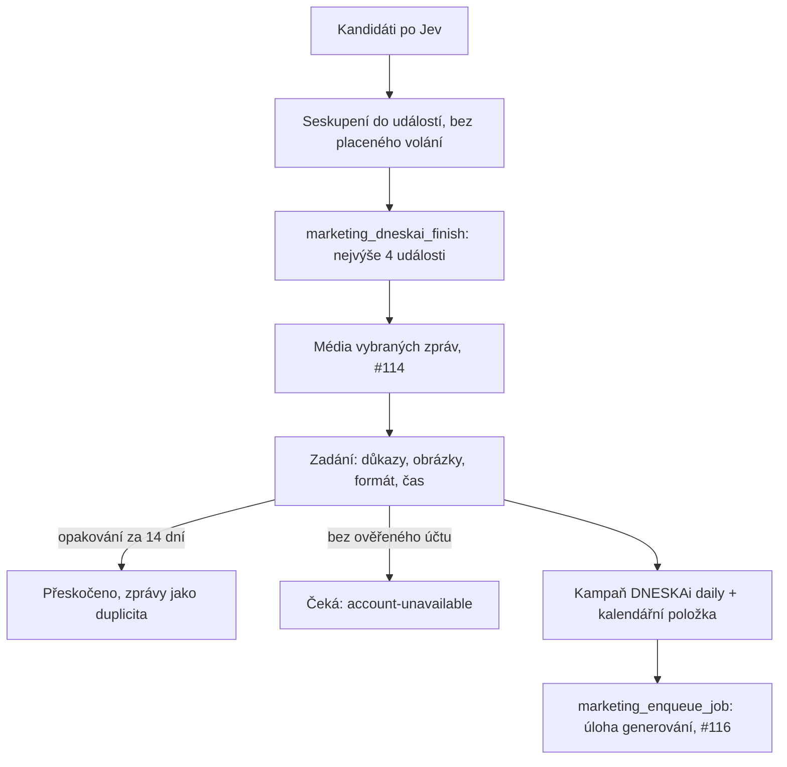

# DNESKAi: události a zadání bez článku (#115)

Večerní sběr (#111, #112) končí výběrem nejvýše čtyř **událostí** na další den. Každá
vybraná událost se po stažení obrázků (#114) změní v **zadání** (brief,
`dneskai-brief/1`) a to v jednu úlohu generování v `marketing_jobs`. Článek
BoardlessAI k tomu není potřeba, Quorum se nevolá a v celé cestě neběží žádný model.
Výběr tématu není ověření faktů ani schválení: vlastník dál schvaluje přesnou
vyrenderovanou revizi.

## Seskupení do událostí

`src/lib/marketing/dneskai-events.ts`, čistá funkce `groupDneskaiEvents`. Dvě zprávy
patří k jedné události, když platí aspoň jedno:

1. Jev označil jednu za duplicitu druhé (`duplicateOf`), bez ohledu na čas v rámci
   čtených oken: duplicity se čtou jen za posledních 7 dní (`DNESKAI_EVENT_READS`),
   takže starší odkaz seskupení nevidí.
2. Mají stejnou primární URL po kanonizaci: bez schématu, `www.`/`m.`/`amp.`,
   sledovacích parametrů, fragmentu, `/amp` a koncového lomítka. Instagram a Hacker
   News se počítají i přes odkaz na článek v textu.
3. Titulky (u Instagramu první řádek popisku, nejvýše 200 znaků) si odpovídají po
   odstranění českých a anglických stop-slov a sjednocení diakritiky (SEL-07):
   - token Jaccard ≥ 0,6 a aspoň dva sdílené tokeny, nebo
   - token Jaccard ≥ 0,45 a aspoň tři sdílené tokeny, z nichž aspoň jeden je entita:
     slovo s velkým písmenem uvnitř titulku psaného větou (`Gemini`, `Nova`) nebo
     slovo se smíšenou velikostí písmen kdekoli (`OpenAI`, `GPT-6`, `iPhone`).

   Čísla se před porovnáním sjednotí: `$40B`, `40 bn`, `40 billion` i `40 mld.` dají
   `40` a `billion` (stejně `m`/`mn`/`milion` → `million`), měnová slova (`dollars`,
   `USD`, `dolarů`, `Kč`) odpadnou, desetinná čárka je tečka a oddělovač tisíců zmizí.
   Různá čísla verzí nebo různá čísla vůbec spojení vylučují: `Ollama 0.12.6` a
   `Ollama 0.12.7` jsou dvě události. Rok (`2026`) a den vedle měsíce (`15 October`,
   `15. října`) zůstávají tokeny, ale jako čísla, která spojení vylučují, se nepočítají.
   `new`, `nova`, `novy`, `nove` jsou stop-slova, kromě případu, kdy stojí s velkým
   písmenem uvnitř titulku psaného větou: `Amazon Nova` je token `nova`. Následuje-li
   další slovo s velkým písmenem, vznikne z obou jeden token vedle toho druhého slova
   (`New York` → `new-york`, `york`), takže `New York` a `New Delhi` nesdílí `new`.
   V titulku psaném Title Case velké písmeno nic neznamená: `New` je tam stop-slovo
   a entitou je jen slovo se smíšenou velikostí písmen.

Pravidla 2 a 3 spojují jen zprávy publikované do 72 hodin od sebe.

- `eventId` = sha256 z `dneskai-event/1\n` + id nejdříve sebrané zprávy. Pozdější
  zpráva o téže události ID nezmění.
- `memberHash` = sha256 z `dneskai-event-members/1\n` + seřazených řádků
  `id:contentHash`. SQL (`marketing_private.dneskai_member_hash`) počítá totéž.

## Výběr v SQL

`marketing_dneskai_finish` (migrace `20261021123547_dneskai_events_briefs.sql`) dostává
seskupení jako `p_events` (jen události se dvěma a více zprávami; jednotlivá zpráva je
událost sama o sobě). SQL ověří jen tvar seskupení: nejvýše 300 událostí po 2–300
zprávách, každá událost je pojmenovaná svou kotvou a žádná zpráva není ve dvou.
Pravidla seskupení (72 hodin, URL, tokeny titulků) SQL nekontroluje.

Seskupení počítá `createDneskaiCollectionStore().finish` (`finishEvents`). Čte od
nejnovějších, po stránkách po tisíci řádcích (`DNESKAI_EVENT_READS`):

- otevřené zprávy (`new`) za 30 dní, nejvýše 2000,
- vybrané zprávy (`selected`) za 30 dní, nejvýše 1000,
- duplicity (`duplicate`) za 7 dní, nejvýše 1000.

Posílá jen události, ve kterých je aspoň jedna otevřená zpráva; jiné vybrat nejde. Nad
300 událostí vyhrají ty s naposledy sebranou zprávou. Když čtení nebo seznam událostí
narazí na limit, běh dostane kód `collection-event-window-partial` (pokud už nemá jiný)
a záložka Zdroje ho ukáže slovy. Doba seskupení závisí na datech: při měření
22. 10. 2026 trvalo 3000 syntetických zpráv 70 ms a 3000 zpráv v 300 desetičlenných
událostech s podobnými titulky 1,47 s.

- Událost vede její nejlepší způsobilá zpráva (dosavadní podmínky: kategorie mimo
  `other`, relevance ≥ 0,85, bez duplicity, bez důvodu vyřazení (`reason`), datum
  vyplněné, ne v budoucnosti a do 48 h u zpráv a do 30 dní jinak).
- Kategorie události (SEL-10, připraveno 22. 10. 2026): většina mezi jejími způsobilými
  zprávami; při shodě rozhodnou zprávy zdrojů tieru 0 a 1 (vydavatel, redakce), pak
  nejrelevantnější zpráva. Spočítá ji `dneskaiEventCategory` při seskupení a pošle jako
  volitelné `category` v `p_events`. Nasazená funkce klíč ignoruje a bere kategorii vedoucí
  zprávy; teprve neaplikovaná migrace `20261022160000_dneskai_event_majority_category.sql`
  ji použije, a jen když ji nese aspoň jedna způsobilá zpráva události. Vedoucí zpráva,
  okno 48 h / 30 dní každé zprávy se nemění; `tool` a `ai-project` zůstávají jako štítek
  dvě kategorie. Každá zpráva dál ukazuje svůj vlastní štítek od Jeva.
- Nejvýše čtyři události. Nasazená funkce bere nejdřív jednu za každou kategorii, pak
  podle relevance. Méně je v pořádku, nic se nedoplňuje.
- Výběr podle relevance (rozhodnutí vlastníka 11 a 12 z 22. 10. 2026, připraveno v
  neaplikované migraci `20261022180000_dneskai_relevance_first_selection.sql`): události
  se seřadí podle relevance vedoucí zprávy, pak podle novějšího data. Zprávy (`ai-news`,
  `tech-news`) soutěží jen relevancí; `tool`, `ai-project` a `marketing` sdílejí jedno
  místo denně, takže projde jen nejrelevantnější z nich. Slabý projekt s AI tak už
  nevytlačí silnou zprávu. Hranice 0,85, okna 48 h / 30 dní, seskupení, pokrytí a limit
  čtyř událostí zůstávají. Pořadí 1 je nejrelevantnější událost a dostane první volný čas.
  Pravidlo platí od aplikace migrace; vysvětlení v záložce Zdroje („Proč ne“) ho popíše
  až se zapnutým `DNESKAI_SELECTION_V2_ENABLED`.
- Událost byla pokrytá dřív, když v ní je dříve vybraná zpráva, nebo Jev duplicita,
  jejíž odkaz vede mimo událost a končí u vybrané zprávy nebo u revize DNESKAi.
  `marketing_private.dneskai_covering_id` sleduje `duplicateOf` přes duplicity, nejvýše
  osm kroků. Jev duplicita zadržené, odmítnuté nebo ještě otevřené zprávy nepokrývá nic.
  Pokrytá událost se nevybere a její otevřené zprávy dostanou `duplicate` s důvodem
  `collection-already-covered` a `duplicateOf` na zprávu nebo revizi, která ji pokryla.
- Všechny klasifikované zprávy vybrané události dostanou `selected` a cílový den, aby
  pro ně sběr médií stáhl obrázky. Nejvýše osm; další se složí do vedoucí zprávy
  (`collection-event-member-overflow`).
- Za každou vybranou událost vznikne řádek `marketing_dneskai_briefs` ve stavu
  `pending`. `selected_count` běhu počítá události, ne zprávy.
- Zadržení starých a nedatovaných zpráv zůstává beze změny.

### Druhá šance pro zadržené zprávy (rozhodnutí 13)

Zpráva, kterou Jev zadržel ke kontrole (`collection-review-*`), dostane jednu automatickou
druhou kontrolu. Připravuje to neaplikovaná migrace `20261022180100_dneskai_held_requeue.sql`
a sběr ji volá jen se zapnutým `DNESKAI_SELECTION_V2_ENABLED`. Večerní běh před naplánováním
dávek Jeva (`marketing_dneskai_requeue_held`) vrátí do fronty nejvýše 16 takových zpráv,
nejrelevantnější první, když:

- je Jev zadržel před méně než 48 hodinami,
- mají text a vyšly za posledních 30 dní, ne v budoucnosti (stejná pravidla jako ruční
  „Znovu zkontrolovat“, `marketing_dneskai_release_candidate`),
- ještě nikdy nebyly vrácené (`requeued_at`, sloupec se nikdy nemaže).

Zpráva dostane stav `new` a smaže se jí klasifikace; titulek, text, URL a data zůstanou.
Jev ji posoudí v dávkách téže noci pod stávajícími limity (nejvýše 16 dávek, $0,25 denně);
navíc jsou to nejvýše dvě dávky po $0,003. Když ji Jev zadrží znovu, zůstane zadržená.
Opakovaný tick téhož běhu už nic nevrátí. Vrácení není schválení.

### Podobné titulky (rozhodnutí 14)

Bez změny: `Meta releases Llama 4 8B` a `Meta releases Llama 4 70B` jsou jedna událost,
protože sdílejí číslo vydání `4` a titulky se shodují z 5 ze 7 tokenů. Bez sdíleného čísla
(`Llama 8B` a `Llama 70B`) je velikost jiné číslo a zprávy zůstanou dvě. Obojí hlídá
`tests/lib/marketing-dneskai-events.test.ts`.

## Zadání

`createDneskaiBriefs` (`src/lib/marketing/dneskai-briefs.ts`), port
`CreateDneskaiBriefs`, zapojený v `getCreateDneskaiBriefs(db)`. Plánovač (#120) ho volá
po sběru médií s `{ owner, project, runId }`; je idempotentní a druhé volání nic nového
nevytvoří. `pending: true` znamená, že některé zadání ještě čeká: jeho zpráva na média
(`pendingDneskaiMediaCandidates` nebo nedokončený `marketing_media_collections`), na
ověřený účet, nebo na zařazení, které selhalo s kódem, jenž může pominout (viz
[Zařazení do fronty](#zařazení-do-fronty)).

Pro každou událost v pořadí:

1. **Důkazy**: první je hlavní zdroj. Vydavatel nebo jeho vlastní účet (blogy
   laboratoří, GitHub releases, arXiv, `@mosseri`, `@meta.ai`) před redakcí, redakce
   před agregátorem (Hacker News, TechCrunch, souhrnné instagramové účty). Pak více
   použitelných obrázků, pak novější zpráva. Zpráva bez odkazu https se citovat nedá a
   vynechá se. `captionOnly` nese každý důkaz zvlášť.
2. **Média**: `dneskaiOfferableMediaAssets` z #114, u každé zprávy v původním pořadí,
   hlavní zdroj první, bez opakování, nejvýše 20.
3. **Formát** (`dneskaiSuggestedFormat`, briefs-01): rozhoduje balík důkazů, ne počet
   obrázků. `single-image` jen pro tenký balík: hlavní zpráva má méně než 400 znaků
   (`DNESKAI_BRIEF_SINGLE_TEXT_LIMIT`, spodní hranice pro textový single) a všechny
   různé zprávy události dohromady méně než 800 znaků (`DNESKAI_BRIEF_CAROUSEL_EVIDENCE_MIN`).
   Jinak `carousel`, i s jedním nebo žádným obrázkem: takový karusel stojí na
   textových slidech (`statement`, u jednoho obrázku i `figure` nebo `split`) a generování
   nikdy nepřidá obrázek, který zadání nenabízí. Za zprávu se počítá delší z textu z feedu
   a textu článku; text článku se počítá jen v brief/2 (`DNESKAI_RICH_EVIDENCE_ENABLED`),
   striktní brief/1 vidí jen text z feedu. Stejný text dvou zpráv se počítá jednou.
4. **Platnost**: 48 hodin pro `ai-news` a `tech-news`, 14 dní pro `tool`,
   `ai-project` a `marketing`, počítáno od vytvoření zadání.
5. **Čas**: `DNESKAI_BRIEF_SLOTS` = 08:00, 12:30, 17:00 a 20:00 Europe/Prague, přes
   `pragueScheduledAt`, takže 25. 10. 2026 (konec letního času) dává 07:00, 11:30,
   16:00 a 19:00 UTC. Události dostávají časy v pořadí svého pořadí výběru, i ta, která
   ještě čeká na média. Čas se přeskočí, když je do hodiny od jiného příspěvku nebo
   zadání téhož dne, nebo když do něj zbývá méně než 30 minut. Stejná hranice platí pro
   zadání, které čas už má a čeká na účet nebo na nové zařazení: méně než 30 minut před
   svým časem se přeskočí (`brief-slot-passed`). Den, do jehož posledního času zbývá
   méně než 30 minut, se uzavře: hotové zadání s časem dostane `brief-slot-passed`,
   zadání, které se nestihlo sestavit, `brief-target-date-passed`. `brief-expired`
   v běžném běhu nenastane, protože platnost (nejméně 48 hodin od vytvoření) trvá
   déle než cesta k času zadání (méně než 24 hodin).

### Opakování za 14 dní

Před uložením se zadání porovná s připravenými a publikovanými revizemi DNESKAi za
posledních 14 dní (`review`, `approved`, `publishing`, `published`, `reconciliation`,
`returned`, `skipped`) a se zařazenými zadáními jiných běhů. Opakování je:

- shodná kanonická URL důkazu se zdrojem nebo důkazem revize (`marketing_sources`),
- titulek některé zprávy zadání, který opakuje titulek zdroje nebo důkazu revize či jiného
  zadání (briefs-15, `dneskaiHeadlinesRepeat`): stejné tokeny jako při seskupování událostí,
  Jaccard aspoň 0,6 a aspoň 2 společné tokeny, porovnává se první řádek titulku. Jiné číslo
  nebo verze (`Ollama 0.12.6` a `0.12.7`) shodu vylučuje. Volnější druhý stupeň seskupení
  (0,45 se jménem) se tu nepoužije, protože 14 dní je mnohem víc než 72 hodin. Takto se
  chytí navazující zpráva s novou URL i novým obrázkem. Revize a zadání uložené před touto
  změnou se čtou stejně, titulky se berou z jejich uložených zdrojů,
- stejný obrázek jako v decku revize (stejný sha256),
- nebo stejná fotka v jiném rozlišení: pHash do 3 bitů. Přísnější než značka duplicity
  v #114 (6 bitů), protože různé slidy jedné šablony leží 4 až 6 bitů od sebe.

Obrázek, který nesou aspoň tři různé články jednoho webu (`dneskaiSitewidePictures`,
`DNESKAI_SITEWIDE_PICTURE_ARTICLES`), je karta celého webu, třeba logo arXivu jako
`og:image`. Do porovnání obrázků se nepočítá. Zprávy téže události se do těch tří
nepočítají, shoda URL platí dál.

Opakování zadání nevytvoří: řádek přejde do `skipped` s kódem
`collection-already-covered` a jeho zprávy dostanou `duplicate` s `duplicateOf` na
revizi nebo zprávu, která téma pokryla.

## Zařazení do fronty

`enqueueBriefJob`:

1. SourcePacket `kind: 'brief'` (`dneskaiBriefSourcePacket`,
   `src/lib/marketing/dneskai-brief-source.ts`): `sourceId` = `eventId`,
   `sourceRevision` = `memberHash`, `contentHash` z obsahu, `canonicalUrl` = URL hlavního
   důkazu, `locale: cs`, `observedAt` a `expiresAt` ze zadání, `eligible: true`, obsah
   `title`, `body` (text hlavní zprávy), `category`, `evidence` (`checkedAt` =
   `observedAt` zadání), `image: null`. `parseSourcePacket` kontroluje, že revize,
   kanonická URL, kategorie a platnost odpovídají zadání.
2. Paket se uloží jako hlava zdroje (`marketing_ingest_source`).
3. `marketing_dneskai_admit_brief` založí aktivní kampaň **DNESKAi daily** (jednou na
   vlastníka, 10 let platnosti) a jednu kalendářní položku na zadání: `carousel` nebo
   `post`, `instagram`, den a čas zadání, `original` = shrnutí zadání, vázaná na hlavu
   zdroje. Jinou aktivní kampaň DNESKAi nikdy nepřevezme (`campaign-conflict`).
4. `enqueueMarketingJob` → `marketing_enqueue_job`: platí `marketing_calendar_job_current`
   i limit 8 úloh za 24 hodin. Požadavek nenese šablonu ani znalosti; `templateVersion`
   je verze vendorovaného studia. `enqueueMarketingJob` ho parsuje přes
   `MarketingJobRequestSchema`, který vedle požadavku se šablonou přijímá
   `DneskaiDeckJobRequestSchema` (#116), a úloha vznikne.
5. `marketing_dneskai_brief_queued` zapíše `job_id`, stav `queued`.

Bez ověřeného řádku `marketing_accounts` pro dneskai/instagram zadání vznikne, ale
zůstane `pending` s kódem `account-unavailable` a úloha se nevytvoří. Další volání ho
zařadí, jakmile účet existuje. Selhání zařazení nechá zadání `ready` s kódem chyby.

Plánovač volá znovu jen tehdy, když výsledek zůstane `pending: true`. Kromě čekání na
média to platí pro:

- zadání, které čeká na ověřený účet (`account-unavailable`),
- selhání zařazení s kódem z `DNESKAI_BRIEF_RETRYABLE_CODES`: `job-budget-exhausted`,
  `marketing-consent-required`, `job-enqueue-failed`, `marketing-account-unavailable`,
  `brief-store-unavailable` a `brief-source-save-failed`,
- selhání prvního uložení zadání s kódem `brief-slot-taken` nebo s kódem z téhož
  seznamu. Řádek zůstane `pending` bez zadání a další volání ho sestaví znovu s dalším
  volným časem.

Krok plánovače nemá pro zadání žádný odklad, takže se pokus opakuje jednou za
pětiminutový tik. Končí, když do času zadání zbývá méně než 30 minut
(`brief-slot-passed`, i u posledního času dne). Nesestavené zadání končí, když do
posledního času cílového dne zbývá méně než 30 minut (`brief-target-date-passed`). Jiné kódy zařazení (`job-request-invalid`,
`template-revision-mismatch`, `source-unavailable`, `campaign-conflict`,
`brief-entry-changed`, `brief-closed`, `brief-not-ready`, `brief-source-unavailable`,
`calendar-entry-unavailable` a další) nechají zadání `ready` a plánovač kvůli nim znovu
nevolá. Zopakují se jen při volání, které drží otevřené jiné zadání téhož běhu.

Když úloha vznikla, ale zápis `job_id` selhal, vrátí `marketing_dneskai_admit_brief`
při dalším volání úlohu aktuální verze kalendářní položky a zadání si ji zapíše, pokud
do jeho času zbývá aspoň 30 minut. Druhá úloha nevznikne, ani když položka mezitím
opustila stav `planned`.

## Obnova zdroje

`refreshSource` a `refreshMarketingSources` čtou brief z `marketing_dneskai_briefs`
(`marketing_dneskai_brief_source`), nikdy z bridge Quorum, a bridge dostane jen
zbývající ID článků. Rozhoduje `kind` předchozího paketu.

- Worker před generováním i po ní: `executeMarketingJob` předává vlastníka a klienta
  jako třetí argument `refreshSource`.
- Publikační brána a její preflight: `synchronizeMarketingSources(db, owner, …)`.
- Offline import (`importMarketingOfflineDraft`) a preflight renderu
  (`runMarketingRenderPreflight`) předávají vlastníka a klienta stejně jako worker.
- Obnovený paket má čerstvé `observedAt` a jinak stejnou identitu.
- Zadání, jehož vybrané zprávy už nejsou ty, ze kterých vzniklo (jiný `memberHash` nebo
  méně zpráv), vrátí `eligible: false` s `brief-members-changed`; přeskočené zadání
  s kódem přeskočení. Prošlé zadání vrátí své prošlé `expiresAt`. Chybějící nebo
  nečitelné zadání a volání bez vlastníka se zadrží, nic se nenahrazuje.

## Stavy a kódy

| Stav | Kód | Význam |
|---|---|---|
| `pending` | – | čeká na média ze zdrojů, nebo se po selhání prvního uložení sestaví znovu |
| `pending` | `account-unavailable` | zadání hotové, chybí ověřený účet `@dneskai`; plánovač to zkouší každý tik |
| `ready` | – / kód z `DNESKAI_BRIEF_RETRYABLE_CODES` | zadání hotové, zařazení se zopakuje při dalším tiku |
| `ready` | jiný kód chyby, např. `job-request-invalid`, `campaign-conflict`, `brief-entry-changed`, `brief-closed`, `brief-not-ready`, `brief-source-unavailable`, `calendar-entry-unavailable` | zadání hotové, zařazení selhalo a plánovač ho sám nezopakuje |
| `queued` | – | úloha generování existuje (`job_id`) |
| `skipped` | `collection-already-covered` | opakování příspěvku nebo zadání z posledních 14 dní |
| `skipped` | `brief-members-changed`, `brief-slot-unavailable`, `brief-slot-passed`, `brief-target-date-passed`, `brief-evidence-unavailable`, `brief-expired`, `brief-invalid` | zadání nevzniklo nebo už neplatí |

Volání, které nenačte dokončený běh sběru, skončí chybou `brief-run-unavailable` a žádné
zadání nezmění.

## Rozhraní

- Záložka **Zdroje** ukazuje pro dnešek a zítřek události místo jednotlivých
  kandidátů: hlavní zdroj, další zprávy, stav zadání a plánovaný čas. Pod nimi jsou
  další nedávné události s důvodem slovy (zadržená, duplicita, mimo témata).
- `readDneskaiBriefs(db, owner, project, date?)` (`dneskai-brief-read.ts`) je čtení
  pro #119: události, zprávy s rolí `primary`/`supporting`, stav, kód, čas, formát a
  počty důkazů a médií.
- `getBriefAssetHashLister(db, owner)`: úprava revize smí použít obrázky zadání, ze
  kterého revize vznikla (`sources[0]`: `eventId` a `memberHash`), a obrázky, které deck
  už má.

## Omezení

- n8n operace `enqueue` s hotovým jobem volá `refreshSource` bez vlastníka, takže brief
  přes ni neprojde (`source-recheck-unavailable`). Zadání zařazuje jen
  `createDneskaiBriefs`.
- Karta celého webu se pozná až ve chvíli, kdy ji nesou tři články. Do té doby může
  shoda obrázku přeskočit zadání jako opakování.
- Nad limity čtení (2000 otevřených, 1000 vybraných, 1000 duplicit) se zprávy
  neseskupí a jedna událost se může vybrat dvakrát. Běh to ukáže kódem
  `collection-event-window-partial`.

## Richer evidence (brief/2, prepared 22 October 2026)

New briefs use `dneskai-brief/2`; the strict reader still accepts unmodified `dneskai-brief/1` snapshots. RSS projection prefers `content:encoded`, then content and the description fallback. During the existing public-page media read, the collector keeps up to 4,000 characters of sanitized article/main prose, plus bounded alt/figcaption metadata in the fixed image plan. Navigation, scripts, hidden text and instruction-shaped text do not become evidence. No extra request is made to obtain this text.

The richer text travels through the owner-scoped media read into a new brief, its source packet and the bounded generation offer. Article text counts toward the format thresholds (400 characters for the primary report, 800 for the whole pack); source alt text is metadata, not a vision result or fact verification. The offer keeps the same evidence-size plans, source ordering and token/cost guards. Caption-only evidence never receives article prose or becomes a transcript. Historical briefs are not rewritten.

The matching migrations are unapplied; production needs a separately approved release after migration-history reconciliation.

## Titling switch (#153)

With `DNESKAI_TITLING_ENABLED=true` (and `DNESKAI_TOPICS_ENABLED=true`) the briefs step stops building and admitting
briefs on its own. For each finished run it turns the selected events into `news` topics instead: one per event,
`source_ref = event:<eventId>`, `brief_id` pointing at the event's brief row, the member URLs and the lead report's
text as evidence. The brief rows stay `pending`, so the Lab's "Generate now" still works on them. Titling then gives
each topic a Czech working title, and a news topic still proposed 48 hours later moves to `expired`. Building a
brief from an approved topic is the next step (A6); until it ships, approving a news topic does not make a post.
With the switch off the step is unchanged.

## Topic briefs (#155)

With `DNESKAI_TOPIC_BRIEFS_ENABLED=true` the tick's `enrichment` step, right after briefs and under the same lease,
takes approved topics through this same path. A news topic builds and admits the brief row of its event (the
night's selection, ranks 1–4). An education topic from a collected report gets its own brief row in the report's
run (rank 5–16, `topic_id`) for today when a slot at least 30 minutes ahead is free, otherwise tomorrow; the report
becomes `selected` for that day, so the media step collects its pictures before the brief is built. Repeat checks,
slot rules, the calendar entry, `marketing_enqueue_job` and the owner's approval of the rendered post are unchanged.
The topic moves `approved` → `enriching` → `briefed` (job queued) → `generated` (draft in review); a lapsed brief
leaves its code in `evidence.bridgeCode`. The brief step without `only` never touches a topic's brief.

**Link-library and manual topics (#210).** They have no collected report, so the bridge makes one. It reads the
topic's first https URL through Jina Reader (only the URL is sent, `dneskai-topic-source.ts`), stores the page as a
candidate `owner-link:<topic id>` with source `owner-link` in the project's newest finished collection run and keeps
its id in `evidence.reportId`. A page already stored under the same normalised URL is reused instead. From there the
topic takes the education path above: the report is selected for its day, the media step collects its pictures (an
`owner-link` report counts as its own site, so only that site's pictures are offered) and the brief is built and
admitted. Codes the owner sees under the topic in Náměty:

| Code | When | Next |
| --- | --- | --- |
| `topic-source-missing` | A manual topic with a title and no URL. A post needs a source it can cite. | Final; add the topic again with a link. |
| `topic-source-unreadable` | The reader returned nothing. | Tried on the next pass, final after three tries. |
| `topic-run-unavailable` | No collection run has finished yet. | Tried on the next pass. |
| `topic-source-unsupported` | A source the bridge cannot use, or no reader wired. | Final. |

## Daily mix (#156)

With `DNESKAI_DAILY_MIX_ENABLED=true` the owner's mix from Zdroje → Denní mix (default 1 news and 1 education post,
08:00 and 17:00) steers the topic path: the briefs step turns the best three events per wanted news post into news
topics (none for zero), the bridge commits to a day only as many topics of each kind as the mix asks and moves the
rest to the next day or keeps them waiting with `topic-daily-mix-full`, and every slot comes from the active times.
The four times stay one list in code and SQL; the mix only switches some off.
