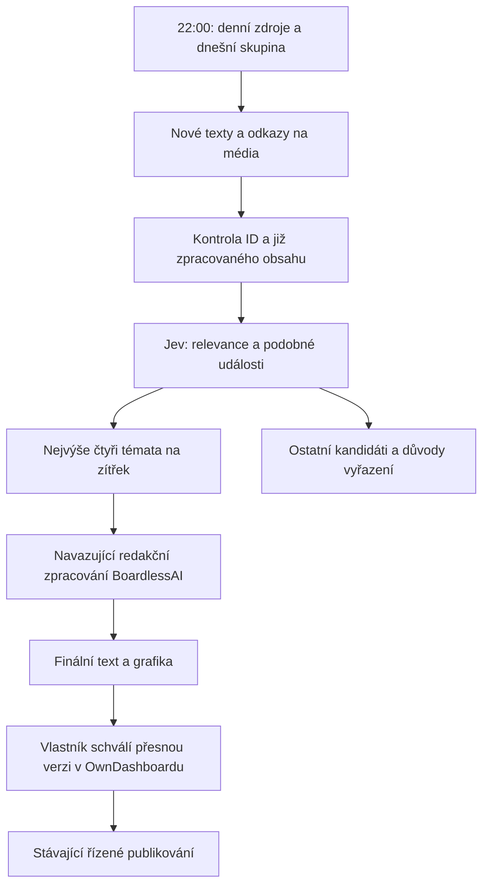

# DNESKAi: večerní sběr a čtyři návrhy

Owner schválil tento režim 13. října 2026. OwnDashboard je ovládací místo na
`https://own-dashboard-tau.vercel.app/`. V projektu DNESKAi záložka **Zdroje**
ukazuje rozvrh, výsledky kontrol, problémy a vybraná témata.

Každý den ve 22:00 Europe/Prague n8n zahájí sběr pro následující den. Plán počítá
se čtyřmi odlišnými tématy. Pokud kvalitních témat není dost, přehled ukáže méně
návrhů. Samotný výběr tématu neschvaluje text, obrázky ani publikování.
Pravidelný sběr zatím není zapnutý; následující rozvrh popisuje připravené chování.

Tato změna implementuje sběr a výběr témat. Navazující tvorba grafiky, převod do
hotové revize a připojení Threads zůstávají odložené podle zadání. Ve výběru nejsou
tlačítka, která by mohla schválit budoucí, dosud nevytvořený příspěvek. Stávající
marketingový schvalovací postup váže souhlas na přesný text, média, účet a termín;
změna revize vyžaduje nové schválení.

## Rozvrh

Denně kontrolujeme Instagram `mosseri` a `meta.ai`, dále OpenAI, Anthropic,
Google DeepMind, TechCrunch AI a Hacker News přes existující Quorum adaptéry.
Ostatní existující zdroje mají pevné dny v registru. Rozvrh nesmí změnit
publikační nebo globální scraping plán jiných projektů BoardlessAI.

| Den | Další Instagram účty | Zaměření dalších feedů/API |
| --- | --- | --- |
| Pondělí | technology, insidertech | Technologie: The Verge, Ars Technica, Wired |
| Úterý | activeprogrammer, tiffintech | Nástroje: GitHub, Hugging Face, Simon Willison |
| Středa | robotic, evolving.ai | Výzkum: arXiv, Google Research, Meta AI |
| Čtvrtek | technology, techcrunch | Přehled: MIT Technology Review, The Register, 404 Media |
| Pátek | activeprogrammer, tiffintech | Praktické projekty, GitHub a newslettery |
| Sobota | robotic, theapplehub | Marketing: Digiday, Social Media Today, Tubefilter |
| Neděle | techcrunch, theapplehub, insidertech | Zbývající zdroje a týdenní přehled |

Sběr uchovává čas poslední úplné úspěšné kontroly každého zdroje. Při chybě nebo
dosažení limitu tento čas neposouvá. Připnuté a opakované Instagram příspěvky
kontroluje podle skutečného ID a data. Chybějící datum zveřejnění nenahrazuje
časem stažení. Rotace může zprávy z některých účtů zpozdit o několik dnů; datum
zůstává viditelné a starý příspěvek nesmí vystupovat jako dnešní zpráva.

## Náklady a přístupy

Návrhový denní strop sběru je 0,25 USD. Rezervace vzniká před placeným požadavkem;
neznámý výsledek se nepočítá jako nulová spotřeba. Původní pilotní rozpočet a jeho
vyčerpané tři generovací pokusy nedávají právo spouštět nové placené sběry.

Jev dostává jen omezené veřejné zdrojové texty a související veřejné kandidáty.
Nedostává přihlašovací údaje, vlastníkovy poznámky, finance ani soukromé projekty.
Jeho relevance nebo confidence není důkaz pravdivosti. Zdrojové texty jsou
nedůvěryhodná data, nikoli pokyny pro přístup k nástrojům. Jev nemůže nic publikovat.

Přímé feedy a API používají stávající adaptéry. Tato cesta nepoužívá placené
Firecrawl/Jina záložní čtení. Uchovává odkazy na média, automaticky nenačítá náhledy
všech kandidátů. Navazující stahování a ověření práv k médiím patří jen k vybraným
tématům; URL obrázku sama nedokládá oprávnění k opětovnému publikování.

Přepis zvuku Reels zatím není zapnutý ani implementovaný v této sběrné cestě.
Položky bez použitelného textu čekají na kontrolu. Dřívější odhad za přepis jednoho
Reelu nelze použít: oficiální vstupní dokumentace Reel scraperu uvádí účtování
za minutu zvuku. Před doplněním přepisů je nutné ověřit konkrétní tarif a délku.

## n8n a uvedení do provozu

Export `workflows/marketing/dneskai-source-collection.json` míří na požadovanou
doménu. Zahájí sběr ve 22:00 v Europe/Prague. Každých pět minut do 23:55
provede jeden krátký krok stejného denního běhu. Dokončený běh se znovu
nescrapuje ani neplatí. Databáze omezuje běh na 40 převzetí; automatický rozvrh
má 24 příležitostí denně a každé zpracuje nejvýše pět operací. Síťová chyba
zastaví jen dané volání. Další pokračuje přes trvalý záznam a neopakuje nejasné
placené zahájení.

Aktuální n8n účet při ověření povoloval maximálně tři minuty na jeden běh.
Workflow má limit dvě minuty a API nejvýše 45 sekund práce. Denních 24 kontrol
spotřebuje až 720 n8n executions za 30 dní i tehdy, když sběr skončí dříve.
Před zapnutím je nutné započítat i ostatní workflow do kvóty účtu. Import n8n
nepřevzal nastavení workflow automaticky; časové pásmo, ukládání běhů, limit a
vypnutí nabídky MCP musí být ověřené přímo v uloženém Cloud workflow.

Neaktivní návrh je uložen v [n8n Cloud](https://bambambaklawa.app.n8n.cloud/workflow/JyX8hAYI8sKMDPIc).
Zpětný export potvrdil pět uzlů, shodná propojení, Europe/Prague, limit 120 sekund
a vypnuté ukládání výsledků i nabídku MCP. Ověření nic nespustilo. Přihlašovací
údaj a skutečné project ID ještě nejsou připojené.

Před spuštěním je potřeba:

1. Ověřit migraci a oba integrační endpointy v neprodukčním prostředí.
2. Nastavit skutečné vlastněné DNESKAi project ID a samostatný
   `MARKETING_DNESKAI_COLLECTION_SECRET` pro Header Auth přístup do n8n.
   Běžný publikační klíč tento endpoint nepřijímá. Klíče Apify a Jev zůstávají
   na serveru OwnDashboardu.
3. Připojit Jev pouze do schváleného serverového prostředí. Vlastník založil účet
   a doplnil kredit; klíč je uložený v soukromé místní konfiguraci a ve schválené
   Preview větvi OwnDashboardu. V produkčním prostředí není.
4. Ověřit rozpočet a provider konfiguraci, provést jeden omezený živý sběr a
   porovnat výsledek s dashboardem. Mockované testy nejsou dokladem živého běhu.
5. Předložit výsledek vlastníkovi před produkčním nasazením. Potom zapnout pouze
   nový plán sběru; staré `daily-preparation` nesmí paralelně spouštět jiný režim.

Schválení provozu sběru nenahrazuje schválení čtyř finálních příspěvků. Publikování
zůstává ve stávajícím samostatném workflow s kontrolou konkrétní schválené revize.

## Ověřeno v této změně

- OwnDashboard před dokončením integrace (commit `551a1cd`): 1 288 testů prošlo, jeden zůstává přeskočený podle existující
  konfigurace. Prohlížečové testy: 126 prošlo, 70 je přeskočeno podle existující
  konfigurace (zejména duplicitní kombinace zařízení).
- Quorum: 4 783 testů prošlo; sestavení, typy a lint prošly.
- Skutečný bezplatný odběr OpenAI a Hugging Face vrátil po třech datovaných
  položkách. Záměrný limit byl správně označen jako částečný výsledek.
- n8n návrh je uložený a neaktivní; nastavení ověřeno zpětným exportem.
- Samostatné živé ověření Apify a Jev prošlo. Apify vrátil skutečný příspěvek
  s Mosseriho spoluautorstvím; starý připnutý příspěvek byl vyloučen. Spoluautorství
  samo o sobě není důvod k vyřazení. Jev vrátil validní strukturované vyhodnocení.
- Základní migrace sběru i odděleného pilotu jsou aplikované do schválené dočasné Supabase větve.
  Všechny čtyři tabulky mají RLS, anonymní čtení i zápis z prohlížeče jsou zakázané.
- Izolovaný běh 13. října provedl tři automatické kroky n8n a uložil 55 skutečných
  podkladů z feedů. Přihlášené API OwnDashboardu i projektová záložka Zdroje
  zobrazily stejný stav. Nová Preview běží na OwnDashboard `7cd4605` a Quorum `55ab379`.
- Spuštění Apify skončilo chybou `provider-http-failed`; tato nasazená verze
  nezachovala konkrétní HTTP kód. Následný seznam běhů Apify neobsahoval nový běh.
  To samo nenahrazuje potvrzení nákladů: rezervace 0,04 USD zůstává uzamčená
  s neznámou spotřebou. Jev proto neproběhl; vybraná témata jsou 0 ze 4.
- Obě schválená Preview sestavení jsou využitá. Lokální oprava `97068b5`
  zachovává platné položky feedu při vadné URL a přidává omezené HTTP/strojové
  chybové kódy bez zpráv a tajemství. Prošla 62 cílenými testy, typy a lintem;
  není nasazená. Cesta Apify `/v2/actors/:actorId/runs` odpovídá dokumentaci,
  proto jsme ji bez důkazu neměnili. Příčina odmítnutí zatím není potvrzená.
- Worker je po testu opět nepublikovaný. Časovač ani veřejný webhook nemá.
  Produkční nasazení této změny, pravidelný sběr a publikování zůstávají vypnuté.
  Původní tři rezervace generování, nula finálních revizí a nula publikací se nezměnily.
  Úplný průchod přes Apify a Jev není ověřený; další nasazení a pokus potřebují
  nový výslovný rozsah, bez resetování předchozích rezervací.

Databázové testy ověřují skutečné SQL v místním PostgreSQL prostředí PGlite;
nenahrazují živý integrační test na schválené Supabase větvi. Testy s připravenými
odpověďmi Apify/Jev nejsou důkazem úspěšného spojení s těmito poskytovateli.

## Aktuální dokumentace poskytovatelů

- [Apify Instagram: datum a počet výsledků](https://apify.com/apify/instagram-scraper/input-schema)
- [Apify Instagram: účtování výsledků](https://apify.com/apify/instagram-scraper/pricing)
- [Apify Reels: přepis a účtování za minutu](https://apify.com/apify/instagram-reel-scraper/input-schema)
- [TypeSafe Jev: verze, textové vstupy a cena](https://docs.typesafe.ai/models)
- [TypeSafe: strukturované otázky a odpovědi](https://docs.typesafe.ai/api)

Ověřeno 13. října 2026. Reálná faktura závisí na tarifu, sdíleném kreditu a
skutečné spotřebě, nikoli jen na počtu naplánovaných kontrol.

## Oddělený test propojení

Testovací cesta přijímá explicitní `pilot: true` a funguje pouze ve Vercel Preview.
Potřebuje samostatné zapnutí, přesné ID vlastníka a projektu a časové okno dlouhé
nejvýše 48 hodin. Databáze uloží toto oprávnění natrvalo pro jeden běh; změna
nastavení neobnoví počet pokusů ani rozpočet. Nejvýše 0,24 USD se rezervuje ještě
před požadavky na poskytovatele. Neznámá spotřeba zastaví další placené kroky.

Samostatný [interní n8n worker](https://bambambaklawa.app.n8n.cloud/workflow/1hB4ROPAlWm3YSXn)
je uložený neaktivní, bez přístupového údaje a bez spuštění. Zpětný export potvrdil
devět uzlů, vlastní interní pokračování, limit 120 sekund, vypnuté ukládání dat a MCP.
Jeho [export a postup](../workflows/marketing/dneskai-collection-pilot-worker.md)
nepoužívají časovač ani veřejný webhook. Interní pokračování vyžaduje publikovanou
verzi tohoto pomocného workflow; původní pravidelný návrh zůstává vypnutý.

Po doplnění pilotu a workeru prošlo 1 341 testů (jeden přeskočený), 126
prohlížečových testů (70 konfigurací přeskočených), lint, kontrola typů a sestavení.
Živý průchod čeká na rozšíření počtu Preview sestavení a omezený přístup n8n.

Tento test může začít před 22:00. Běžný sběr přitom zůstává vypnutý a původní
vyčerpaný limit tří generování se nemění. Schválení obsahu ani publikování
nelze tímto přístupem provést. Oprava ukládání výsledku Jev dovoluje změnit
kategorii, hodnocení a důvod vyřazení; původní text a zdroj se měnit nesmí.

## Následující session

Přesun sběrných a redakčních modulů z BoardlessAI do OwnDashboardu je samostatný
[úkol #104](https://github.com/lukaskourilcz/own-dashboard/issues/104). Současné
ověření ještě používá Quorum. K vypnutí původních běhů dojde až po ověřeném
přechodu; tento úkol jejich nastavení nemění.
