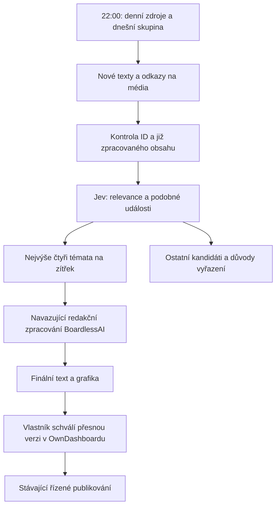

# DNESKAi: večerní sběr a čtyři návrhy

Owner schválil tento režim 13. října 2026. OwnDashboard je ovládací místo na
`https://own-dashboard-tau.vercel.app/`. V projektu DNESKAi záložka **Zdroje**
ukazuje rozvrh, výsledky kontrol, problémy a vybraná témata.

Každý den ve 22:00 Europe/Prague n8n zahájí sběr pro následující den. Plán počítá
se čtyřmi odlišnými tématy. Pokud kvalitních témat není dost, přehled ukáže méně
návrhů. Samotný výběr tématu neschvaluje text, obrázky ani publikování.
Pravidelný sběr zatím není zapnutý; následující rozvrh popisuje připravené chování.

Tato změna implementuje sběr a výběr témat. Navazující tvorba grafiky, převod do
hotové revize a připojení Threads zůstávají odložené podle zadání. Ve výběru nejsou
tlačítka, která by mohla schválit budoucí, dosud nevytvořený příspěvek. Stávající
marketingový schvalovací postup váže souhlas na přesný text, média, účet a termín;
změna revize vyžaduje nové schválení.

## Rozvrh

Denně kontrolujeme Instagram `mosseri` a `meta.ai`, dále OpenAI, Anthropic,
Google DeepMind, TechCrunch AI a Hacker News přes existující Quorum adaptéry.
Ostatní existující zdroje mají pevné dny v registru. Rozvrh nesmí změnit
publikační nebo globální scraping plán jiných projektů BoardlessAI.

| Den | Další Instagram účty | Zaměření dalších feedů/API |
| --- | --- | --- |
| Pondělí | technology, insidertech | Technologie: The Verge, Ars Technica, Wired |
| Úterý | activeprogrammer, tiffintech | Nástroje: GitHub, Hugging Face, Simon Willison |
| Středa | robotic, evolving.ai | Výzkum: arXiv, Google Research, Meta AI |
| Čtvrtek | technology, techcrunch | Přehled: MIT Technology Review, The Register, 404 Media |
| Pátek | activeprogrammer, tiffintech | Praktické projekty, GitHub a newslettery |
| Sobota | robotic, theapplehub | Marketing: Digiday, Social Media Today, Tubefilter |
| Neděle | techcrunch, theapplehub, insidertech | Zbývající zdroje a týdenní přehled |

Sběr uchovává čas poslední úspěšné kontroly každého zdroje (kurzor, od 20. října
2026, #112). Úplná kontrola pod limitem ho posune na začátek běhu. Kontrola, která
skončila jen na limitu položek (`collection-source-item-cap`), ho posune na čas
nejnovější přijaté položky (`publishedAt`, u položky bez data `fetchedAt`), nikdy
za aktuální čas. Další běh tak čte jen novější položky; starší položky za limitem
už nedohání. Chyba, neplatná URL a jiný částečný výsledek kurzor neposouvají.
Připnuté a opakované Instagram příspěvky kontroluje podle skutečného ID a data.

Položka bez data dostane čas stažení jako horní odhad a příznak `dateEstimated`.
Den nebo měsíc bez času je horní odhad: nejpozdější okamžik, kdy v některém časovém
pásmu ještě platí uvedené datum, nejvýše čas stažení. Pravidla aktuálnosti (vstup do
Jev do 30 dnů, výběr zpráv do 48 hodin) platí pro odhad stejně jako pro přesné datum.
Kandidát se stejnou URL se znovu nevkládá, takže položka bez data je čerstvá jen
v běhu, který ji poprvé uložil. Záložka Zdroje odhad označí. Rotace může zprávy
z některých účtů zpozdit o několik dnů; datum zůstává viditelné a starý příspěvek
nesmí vystupovat jako dnešní zpráva.

Denní feedy vracejí nejvýše 20 položek, Instagram 10 na profil a 50 za den.
Kandidát nese nejvýše 10 odkazů na média. Jev dostane po sběru `ceil(nových / 8)`
dávek, nejvýše 16; běh bez nových kandidátů žádnou dávku nevytvoří.

## Náklady a přístupy

Návrhový denní strop sběru je 0,25 USD. Rezervace vzniká před placeným požadavkem;
neznámý výsledek se nepočítá jako nulová spotřeba. Původní pilotní rozpočet a jeho
vyčerpané tři generovací pokusy nedávají právo spouštět nové placené sběry.

Jev dostává jen omezené veřejné zdrojové texty a související veřejné kandidáty.
Nedostává přihlašovací údaje, vlastníkovy poznámky, finance ani soukromé projekty.
Jeho relevance nebo confidence není důkaz pravdivosti. Zdrojové texty jsou
nedůvěryhodná data, nikoli pokyny pro přístup k nástrojům. Jev nemůže nic publikovat.

Přímé feedy a API používají stávající adaptéry. Tato cesta nepoužívá placené
Firecrawl/Jina záložní čtení. Uchovává odkazy na média, automaticky nenačítá náhledy
všech kandidátů. Obrázky se stahují až pro vybraná témata, tutéž noc, a ukládají se
s původem a creditem bez gate práv (rozhodnutí vlastníka 7, #110); viz
[obrázky ze zdrojů](dneskai-source-media.md).

Přepis zvuku Reels zatím není zapnutý ani implementovaný v této sběrné cestě.
Položky bez použitelného textu čekají na kontrolu. Dřívější odhad za přepis jednoho
Reelu nelze použít: oficiální vstupní dokumentace Reel scraperu uvádí účtování
za minutu zvuku. Před doplněním přepisů je nutné ověřit konkrétní tarif a délku.

## n8n a uvedení do provozu

Export `workflows/marketing/dneskai-source-collection.json` míří na požadovanou
doménu. Zahájí sběr ve 22:00 v Europe/Prague. Každých pět minut do 23:55
provede jeden krátký krok stejného denního běhu. Dokončený běh se znovu
nescrapuje ani neplatí. Databáze omezuje běh na 40 převzetí; automatický rozvrh
má 24 příležitostí denně a každé zpracuje nejvýše pět operací. Síťová chyba
zastaví jen dané volání. Další pokračuje přes trvalý záznam a neopakuje nejasné
placené zahájení.

Aktuální n8n účet při ověření povoloval maximálně tři minuty na jeden běh.
Workflow má limit dvě minuty a API nejvýše 45 sekund práce. Denních 24 kontrol
spotřebuje až 720 n8n executions za 30 dní i tehdy, když sběr skončí dříve.
Před zapnutím je nutné započítat i ostatní workflow do kvóty účtu. Import n8n
nepřevzal nastavení workflow automaticky; časové pásmo, ukládání běhů, limit a
vypnutí nabídky MCP musí být ověřené přímo v uloženém Cloud workflow.

Neaktivní návrh je uložen v [n8n Cloud](https://bambambaklawa.app.n8n.cloud/workflow/JyX8hAYI8sKMDPIc).
Zpětný export potvrdil pět uzlů, shodná propojení, Europe/Prague, limit 120 sekund
a vypnuté ukládání výsledků i nabídku MCP. Ověření nic nespustilo. Přihlašovací
údaj a skutečné project ID ještě nejsou připojené.

Před spuštěním je potřeba:

1. Ověřit migraci a oba integrační endpointy v neprodukčním prostředí.
2. Nastavit skutečné vlastněné DNESKAi project ID a samostatný
   `MARKETING_DNESKAI_COLLECTION_SECRET` pro Header Auth přístup do n8n.
   Běžný publikační klíč tento endpoint nepřijímá. Klíče Apify a Jev zůstávají
   na serveru OwnDashboardu.
3. Připojit Jev pouze do schváleného serverového prostředí. Vlastník založil účet
   a doplnil kredit; klíč je uložený v soukromé místní konfiguraci a ve schválené
   Preview větvi OwnDashboardu. Od produkčního propojení 13. října je nastavený
   také v samostatném prostředí Production; pravidelný sběr zůstává vypnutý.
4. Ověřit rozpočet a provider konfiguraci, provést jeden omezený živý sběr a
   porovnat výsledek s dashboardem. Mockované testy nejsou dokladem živého běhu.
5. Předložit výsledek vlastníkovi před produkčním nasazením. Potom zapnout pouze
   nový plán sběru; staré `retired/daily-preparation` nesmí paralelně spouštět jiný režim.

Schválení provozu sběru nenahrazuje schválení čtyř finálních příspěvků. Publikování
zůstává ve stávajícím samostatném workflow s kontrolou konkrétní schválené revize.

## Ověřeno v této změně

### Jednorázové produkční ověření bez denního rozvrhu

`workflows/marketing/retired/dneskai-production-verification.json` (od 20. 10. 2026 retirovaný) je samostatná šablona
pro ruční start a interní pokračování. Nepoužívá původní stagingový worker,
časovač, veřejný webhook ani přístupové cookie Preview. Po importu je neaktivní.

Před spuštěním správce zaregistruje jediný běh pro vlastníka a projekt DNESKAi
přes existující `marketing_dneskai_admit`. Ověří skutečný seznam zdrojů a nastaví
stejné ID běhu do workflow i neveřejné serverové konfigurace
`MARKETING_DNESKAI_MANUAL_RUN`. Konfigurace obsahuje `version: dneskai-manual/1`,
`ownerId`, `projectId`, `runId`, `startsAt` a `expiresAt`; server přijímá nejvýše
dvouhodinové okno. Tento postup nemění databázové stropy 0,25 USD a 40 kroků.
Nejasná placená operace zastaví další placené kroky podle stávajících pravidel.

n8n dostane jen samostatný `MARKETING_DNESKAI_MANUAL_SECRET` jako Header Auth,
nikoli běžný sběrný klíč ani klíče poskytovatelů. Každý požadavek musí obsahovat
`manual: true` a přesné ID registrovaného běhu. Server odmítne běžný požadavek
s tímto klíčem, jiné ID, jiný projekt, Preview prostředí i vypršelý přístup.
Workflow předává pokračování jen samo sobě a při chybě HTTP nic neopakuje.
Platnost server kontroluje znovu před placenou operací.

`MARKETING_DNESKAI_COLLECTION_ENABLED` a `MARKETING_DNESKAI_PAID_ENABLED` mohou
zůstat `false`. Jednorázový režim neuděluje právo vytvářet další běhy a nemění
publikování. Zprovoznění vyžaduje schválený nový rozpočet a přístup n8n; samotná
šablona ani lokální testy nejsou důkazem dokončeného produkčního průchodu.

- OwnDashboard před dokončením integrace (commit `551a1cd`): 1 288 testů prošlo, jeden zůstává přeskočený podle existující
  konfigurace. Prohlížečové testy: 126 prošlo, 70 je přeskočeno podle existující
  konfigurace (zejména duplicitní kombinace zařízení).
- Quorum: 4 783 testů prošlo; sestavení, typy a lint prošly.
- Skutečný bezplatný odběr OpenAI a Hugging Face vrátil po třech datovaných
  položkách. Záměrný limit byl správně označen jako částečný výsledek.
- n8n návrh je uložený a neaktivní; nastavení ověřeno zpětným exportem.
- Samostatné živé ověření Apify a Jev prošlo. Apify vrátil skutečný příspěvek
  s Mosseriho spoluautorstvím; starý připnutý příspěvek byl vyloučen. Spoluautorství
  samo o sobě není důvod k vyřazení. Jev vrátil validní strukturované vyhodnocení.
- Základní migrace sběru i odděleného pilotu jsou aplikované do schválené dočasné Supabase větve.
  Všechny čtyři tabulky mají RLS, anonymní čtení i zápis z prohlížeče jsou zakázané.
- Izolovaný běh 13. října provedl tři automatické kroky n8n a uložil 55 skutečných
  podkladů z feedů. Přihlášené API OwnDashboardu i projektová záložka Zdroje
  zobrazily stejný stav. Nová Preview běží na OwnDashboard `7cd4605` a Quorum `55ab379`.
- Spuštění Apify skončilo chybou `provider-http-failed`; tato nasazená verze
  nezachovala konkrétní HTTP kód. Následný seznam běhů Apify neobsahoval nový běh.
  To samo nenahrazuje potvrzení nákladů: rezervace 0,04 USD zůstává uzamčená
  s neznámou spotřebou. Jev proto neproběhl; vybraná témata jsou 0 ze 4.
- Obě schválená Preview sestavení jsou využitá. Lokální oprava `97068b5`
  zachovává platné položky feedu při vadné URL a přidává omezené HTTP/strojové
  chybové kódy bez zpráv a tajemství. Prošla 62 cílenými testy, typy a lintem;
  byla následně sloučena v PR #100 a nasazena do produkce. Cesta Apify `/v2/actors/:actorId/runs` odpovídá dokumentaci,
  proto jsme ji bez důkazu neměnili. Příčina odmítnutí zatím není potvrzená.

## Produkční propojení 13. října 2026

Na výslovný pokyn vlastníka je všech devět marketingových migrací v produkční
databázi. Před změnou byl do neveřejného místního úložiště uložen stav dotčených
preferencí, původní omezení a pravidla úložiště. Nových 17 marketingových tabulek
má RLS, anonym nemůže spouštět marketingové funkce a úložiště obrázků je soukromé.
Přihlášený vlastník může číst výsledky, ale nemůže přímo měnit revize ani spouštět
sběr přes databázovou funkci. Stagingová data se do produkce nekopírovala.

Production má klíče Apify/Jev a nová samostatná integrační tajemství pro zdrojový
most a sběr. Dočasné Preview cookie ani pilotní konfigurace se nepoužívají.
Sběr, placené operace a publikování jsou vypnuté. Požadavek s platným integračním
klíčem na produkční sběr vrátil očekávané `403 collection-disabled`. Přihlášený
Chrome ověřil načtení registru zdrojů bez chyby konfigurace Apify/Jev.

Nasazení OwnDashboardu `dpl_G7WsuRJcZyUTcxzQDxbHDi72XXCf` je READY na hlavní
doméně a používá již ověřený merge `32ad3d8`. Dřívější kontrola tohoto kódu:
1 357 testů prošlo, jeden byl přeskočen; prohlížečové testy: 126 prošlo,
70 konfigurovaných přeskočení. V tomto kroku se aplikační kód neměnil.

Quorum PR #599 je sloučené v `60ebbef`. Na přesném čistém commitu prošlo
4 784 testů, typy, lint, sestavení a kontrola běžící aplikace. Produkční nasazení
`dpl_2edyiBK5moHA3n9poS7w67nDUprP` je READY na `boardless-ai.vercel.app`.
Podepsaný bezplatný požadavek vrátil HTTP 200 a jeden datovaný podklad z
`openai-blog`, se stavem `ok` a bez chyby. Jde o ověření zdrojového rozhraní;
neprokazuje celý sběr, klasifikaci ani schválení příspěvku. Export schválených
článků zůstává vypnutý, stejně jako pravidelný sběr a publikování.

Lokální Apify klíč prošel kontrolou formátu a bezplatným ověřením účtu. Aktuální
actor i tarif odpovídají připnuté konfiguraci. Příčina dřívějšího HTTP odmítnutí
stále není doložená. Vlastník následně schválil jeden nový test do 0,05 USD.
Apify vrátilo sedm příspěvků za doložených 0,0161 USD. Výsledek zůstává částečný,
protože dosáhl limitu sedmi položek. Jediné volání Jev skončilo HTTP 400;
jeho cenu neznáme a ponecháváme rezervaci 0,003 USD. Požadavek jsme neopakovali
a původní stagingová rezervace 0,04 USD zůstává samostatná.

Offline kontrola uloženého požadavku našla rozdělené emoji v nadpisu. Oprava
zkracuje nadpisy a texty bez neplatných UTF-16 znaků, zachovává dosavadní limity
a původní zdrojový text. Kontrola stejné dávky po opravě nenašla neplatné znaky.
Regresní testy pokrývají hranice textů kandidátů, historie a instagramového
nadpisu. Vlastník pak schválil jedno další volání Jev do 0,003 USD na stejné
uložené dávce, bez nového scrapování. Po opravě Jev vrátilo platné vyhodnocení
sedmi položek za 0,000155064 USD. Všechny zůstaly `held` s důvodem
`collection-classification-uncertain`; relevance byla 0,04–0,40. Prahy jsme
nesnižovali a žádné téma nepovažujeme za vybrané. První HTTP 400 nemá zachovaný
diagnostický text, takže jeho přesnou příčinu nelze doložit. Data testu zůstávají
v soukromých místních dokladech; do produkční databáze jsme je neimportovali.
- Worker je po testu opět nepublikovaný. Časovač ani veřejný webhook nemá.
  Produkční nasazení této změny, pravidelný sběr a publikování zůstávají vypnuté.
  Původní tři rezervace generování, nula finálních revizí a nula publikací se nezměnily.
  Samostatný průchod přes Apify a opravené Jev je ověřený. Celý běh přes n8n
  a uložení do produkční databáze ještě neproběhl; jeho spuštění potřebuje
  nový výslovný rozsah, bez resetování předchozích rezervací.

Databázové testy ověřují skutečné SQL v místním PostgreSQL prostředí PGlite;
nenahrazují živý integrační test na schválené Supabase větvi. Testy s připravenými
odpověďmi Apify/Jev nejsou důkazem úspěšného spojení s těmito poskytovateli.

## Aktuální dokumentace poskytovatelů

- [Apify Instagram: datum a počet výsledků](https://apify.com/apify/instagram-scraper/input-schema)
- [Apify Instagram: účtování výsledků](https://apify.com/apify/instagram-scraper/pricing)
- [Apify Reels: přepis a účtování za minutu](https://apify.com/apify/instagram-reel-scraper/input-schema)
- [TypeSafe Jev: verze, textové vstupy a cena](https://docs.typesafe.ai/models)
- [TypeSafe: strukturované otázky a odpovědi](https://docs.typesafe.ai/api)

Ověřeno 13. října 2026. Reálná faktura závisí na tarifu, sdíleném kreditu a
skutečné spotřebě, nikoli jen na počtu naplánovaných kontrol.

## Oddělený test propojení

Testovací cesta přijímá explicitní `pilot: true` a funguje pouze ve Vercel Preview.
Potřebuje samostatné zapnutí, přesné ID vlastníka a projektu a časové okno dlouhé
nejvýše 48 hodin. Databáze uloží toto oprávnění natrvalo pro jeden běh; změna
nastavení neobnoví počet pokusů ani rozpočet. Nejvýše 0,24 USD se rezervuje ještě
před požadavky na poskytovatele. Neznámá spotřeba zastaví další placené kroky.

Samostatný [interní n8n worker](https://bambambaklawa.app.n8n.cloud/workflow/1hB4ROPAlWm3YSXn)
je uložený neaktivní, bez přístupového údaje a bez spuštění. Zpětný export potvrdil
devět uzlů, vlastní interní pokračování, limit 120 sekund, vypnuté ukládání dat a MCP.
Jeho [export a postup](../workflows/marketing/retired/dneskai-collection-pilot-worker.md)
nepoužívají časovač ani veřejný webhook. Interní pokračování vyžaduje publikovanou
verzi tohoto pomocného workflow; původní pravidelný návrh zůstává vypnutý.

Po doplnění pilotu a workeru prošlo 1 341 testů (jeden přeskočený), 126
prohlížečových testů (70 konfigurací přeskočených), lint, kontrola typů a sestavení.
Živý průchod čeká na rozšíření počtu Preview sestavení a omezený přístup n8n.

Tento test může začít před 22:00. Běžný sběr přitom zůstává vypnutý a původní
vyčerpaný limit tří generování se nemění. Schválení obsahu ani publikování
nelze tímto přístupem provést. Oprava ukládání výsledku Jev dovoluje změnit
kategorii, hodnocení a důvod vyřazení; původní text a zdroj se měnit nesmí.

## Následující session

Přesun sběrných a redakčních modulů z BoardlessAI do OwnDashboardu je samostatný
[úkol #104](https://github.com/lukaskourilcz/own-dashboard/issues/104). Současné
ověření ještě používá Quorum. K vypnutí původních běhů dojde až po ověřeném
přechodu; tento úkol jejich nastavení nemění.

### Apify datum z databáze

Produkční ověření 13. října ukázalo rozdíl mezi vstupem z lokálního testu a databází. PostgreSQL vrací čas například jako `2026-10-06T21:09:06.897873+00:00`. Vstupní schéma připnutého Apify buildu `0.0.813` tento posun odmítá. Před požadavkem ověříme datum a převedeme jej na UTC zápis `2026-10-06T21:09:06.897Z`. Neplatné datum odmítneme před placeným voláním. Lokální filtrování výsledků dál používá původní hranici.

Odmítnutý pokus se automaticky neopakuje. Jeho rezervace zůstává evidovaná; oprava kódu neobnovuje rozpočet ani počet kroků.

### Produkční propojení a zbývající redakční ověření — 13. října 2026

PR #107 opravilo UTC formát pro Apify. Stejný schválený běh pokračoval pouze
na dosud nespuštěné zdroje a Jev, bez resetu limitů. Skončil po 16 krocích:
70 uložených kandidátů, tři úspěšné Instagram zdroje, osm úspěšných dávek Jev
a žádná publikace. API náklady jsou 0,017213294 USD: Apify vykázalo 0,0161 USD
a Jev 0,001113294 USD podle vstupních tokenů a ověřené sazby. Rezervace
odmítnutého activeprogrammer pokusu zůstala 0,04 USD; nebyl opakován.

Výběr zůstal 0/4. Šedesát vyhodnocených kandidátů má nízkou jistotu/relevanci
a deset položek bez data vyřadila kontrola vstupu před placeným vyhodnocením. Propojení
služeb je ověřené, kvalita redakčního výběru ještě ne. Aktuální lokální oprava
používá odkazy jako `items[0]` uzavřené v backtick znacích, jak předepisuje
[TypeSafe: odkazy na konkrétní pole](https://docs.typesafe.ai/primitives#reference-specific-fields).
Relevance se ptá pouze na konkrétní obsah; aktuálnost nadále kontroluje kód.
Prahy jistoty se nesnižují. Úspěšné testy formátu nejsou důkazem lepšího
sémantického výsledku; další placené přehodnocení a nasazení vyžaduje nový
souhlas. Denní sběr i publikování zůstávají vypnuté.

Vlastník následně schválil jedno lokální volání Jev na osmi existujících
veřejných podkladech, do 0,003 USD a bez změn databáze. Stálo 0,00016002 USD.
Dvě relevance vzrostly nad 0,85, ale všech osm položek zůstalo zadržených
kombinovanou podmínkou jistoty. Oprava reference proto není ověřením funkčního
redakčního výběru. Před dalším ostrým během je nutné ukládat oddělené důvody
pro relevanci, kategorii a duplicitu, porovnat je s ručně označeným vzorkem
a ověřit kvalitu v jednom předem ohraničeném evaluačním rozsahu. Žádný práh
se nemění jen proto, aby vznikla čtyři témata. Tento lokální test nezasáhl
produkční databázi ani n8n a neobsahoval další scraping.

## Navazující lokální ověření 14. října

Oprava odděluje nejistotu mezi překrývajícími se kategoriemi od relevance a duplicity.
Devět schválených volání nad uloženými veřejnými daty stálo 0,00203343 USD.
Výsledky, omezení a postup nasazení jsou v [protokolu ověření](dneskai-jev-evaluation-2026-10-14.md).
Produkční data, pravidelný sběr a publikování se nezměnily.
