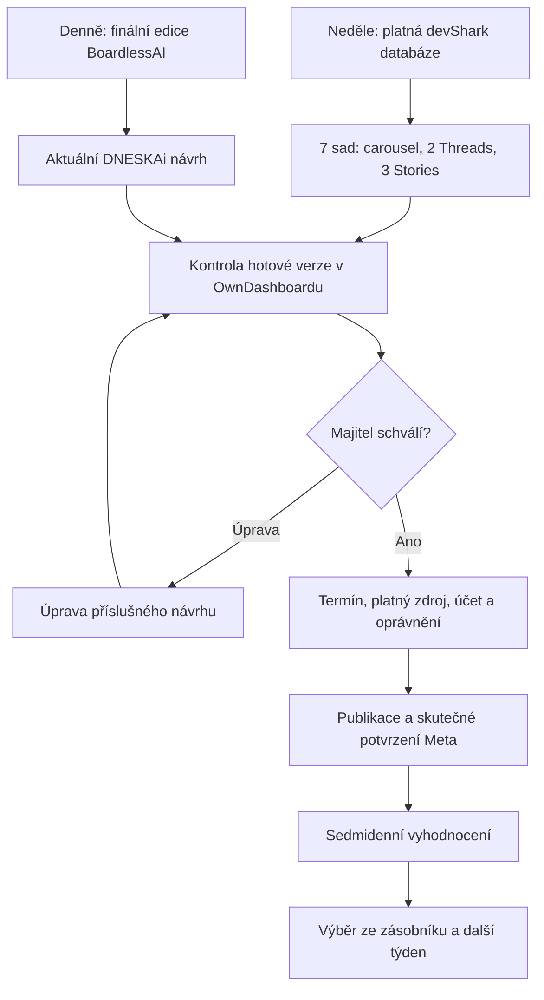

# Marketing po týdnech

Ověřeno 13. října 2026. Tento dokument nahrazuje původní třicetidenní rozvrh pro nový start. Produkční spuštění zatím není schválené.

## Co bude majitel dělat

V neděli v OwnDashboardu projde hotový týden devSharku. Každý den obsahuje jeden IG carousel, dva texty na Threads a tři Stories. První týden je **18.–24. října: 42 příspěvků**. Schválení se vztahuje na přesné obrázky, text, účet a čas. Při změně se příspěvek vrátí ke kontrole.

DNESKAi potřebuje každodenní kontrolu aktuálního návrhu. Vychází z finální edice BoardlessAI; budoucí zprávy se nepředepisují. Pro první týden kalendář obsahuje sedm denních zadání pro IG. Nový požadavek 1/2/3 denně se vztahuje na devShark; stejný objem pro DNESKAi majitel nezadal.

Další neděli majitel projde výsledky, vybere témata ze zásobníku a upraví následujících sedm dní. Výběr tématu ani použití plánu neschvaluje budoucí hotové verze.

Mapa ukazuje cílový proces. Aktuální limity jsou uvedené níže.

## Grafika a text za předvídatelnou cenu

Claude Design slouží k vytvoření a úpravám grafických šablon. Anthropic dokumentuje export do složky, HTML, PDF, PPTX a Canvy a přístup v rámci Max limitů. Ve zkoumané dokumentaci není potvrzené stabilní veřejné API pro bezobslužné hromadné renderování. Automatizace proto používá již exportovanou, verzovanou šablonu a existující renderer. Max předplatné se nesmí zaměňovat za kredit Claude API. [Claude Design](https://www.anthropic.com/news/claude-design-anthropic-labs)

První týden vznikl lokálně z ověřených otázek a existujícího grafického kódu: 28 JPEGů pro sedm carouselů, 21 JPEGů pro Stories a 14 textů na Threads. Žádné další generativní médium, modelové volání nebo placený poskytovatel nebyl použit. Volba původního poskytovatele zůstává Claude Design podle zadání majitele; Dots a Higgsfield nejsou součástí řešení. JPEG export zajišťuje stávající Sharp. [Výstupní formáty Sharp](https://sharp.pixelplumbing.com/api-output/)

Stories používají nový rozměr 1080 × 1920 s odvozenou paletou a typografií. Tato nová sazba potřebuje grafické schválení; původní souhlas s carousel šablonou ji automaticky nepokrývá. Příspěvky zůstávají návrhy. Otázky, možnosti, správné odpovědi, vysvětlení a kód se nepřepisují. Humanizer upravuje pouze úvod, doprovodný text a výzvu. Při nalezené věcné chybě se zdroj vyřadí a vybere jiný platný záznam.

LangChain má připravovat pouze chybějící doprovodný text ve strukturovaném formátu. Ověření odpovědi, počtů, délky, zdroje a rozměrů provádí kód. Jednu zdrojovou sadu lze využít ve více formátech; nevyžaduje 42 samostatných modelových volání. Opakovaný běh se stejným zdrojem, verzí šablony a zadáním má použít uložený výsledek.

LangSmith propojí běh s ID zdroje, verzí promptu, výsledkem kontrol, cenou a zpětnou vazbou majitele. Do trace patří redigovaná metadata, nikoli tokeny a privátní kolekce. Úspěšný trace nepotvrzuje kvalitu obsahu ani zveřejnění; rozhodují kontroly, schválení a skutečné potvrzení platformy. [LangSmith observability](https://docs.langchain.com/langsmith/observability-concepts)

## n8n a publikovací časy

Všechny plánovače potřebují explicitní `Europe/Prague`. Instalovaný Cloud při kontrole uváděl 2.42.7, proto se nelze spoléhat na nové chování plánovače dokumentované až od 2.45.0. Rozvrh začne fungovat teprve publikováním workflow; při zmeškaném termínu se příspěvek nedohání bez nového schváleného času. [n8n Schedule Trigger](https://docs.n8n.io/integrations/builtin/core-nodes/n8n-nodes-base.scheduletrigger/)

- devShark: nedělní zjištění zdrojů pro přesných sedm dat; příprava a kontrola celého balíčku. Současný export poskytuje diagnostiku a výslovně hlásí chybějící části, zatím nespouští 42 generovacích úloh.
- DNESKAi: denní příprava dnešní finální edice. Původní n8n koncept má spouštění v 07:00 a zástupné adresy; při této kontrole nebyl aktivní.
- První návrh časů v kalendáři: Threads 10:00 a 18:00, carousel 19:00, tři Stories společně v 10:00; DNESKAi 12:00. Jde o pracovní časy k finálnímu schválení, nikoli tvrzení o nejlepším dosahu. Nedělní schválení musí předcházet prvnímu slotu.

Tři nové Stories denně poskytují přibližně 24hodinovou sérii. Nezajišťují nepřerušenou dostupnost: záleží na dokončení publikace a přechodu na zimní čas. Dne 25. října má interval mezi stejnými pražskými časy 25 hodin. API nepřidává interaktivní quiz/link stickery tím, že je grafika obsahuje. Automatické ukládání do Highlights není součástí ověřeného řešení. [Meta Stories](https://developers.facebook.com/documentation/instagram-platform/instagram-graph-api/reference/ig-user/media)

Obrázky zůstávají v soukromém úložišti. Před publikací se obnoví krátkodobý odkaz a ověří se shodný obsah. Meta kontejnery vznikají až poblíž termínu. Nedělní podepsaná URL nemusí vydržet do sobotního večera; změna URL se nesmí zaměňovat za změnu schválených obrázků.

## Jak vyhodnotíme první týden

První přehled připadá na 25. října a pokryje 18.–24. října. Jeho závěry budou předběžné: Meta uvádí možné zpoždění metrik až 48 hodin. U nejnovějších příspěvků uvidí majitel stáří a neúplné pokrytí. Pro srovnání použijeme stejně staré příspěvky; sedmidenní výsledek sobotního postu nelze mít už následující neděli. [Meta media insights](https://developers.facebook.com/documentation/instagram-platform/reference/instagram-media/insights)

| Kanál | Co sledovat | Jak to číst |
| --- | --- | --- |
| IG feed | Dosah, zobrazení, uložení, sdílení, komentáře, návštěvy profilu, pokud je endpoint poskytne | Výsledky celého carouselu; ne součet jeho snímků |
| Threads | Zobrazení, odpovědi, reposty, citace, sdílení | Samostatné příspěvky a skutečné ID; porovnat otázku s vysvětlením |
| Stories | Dostupné metriky jednotlivých snímků | Sběr během jejich dostupnosti; chybějící údaj není nula |
| Systém | Připraveno, vráceno, schváleno, publikováno, cena | Nezaměňovat tyto provozní stavy za dosah |

Pokud je dosah známý a nenulový, lze uvést například `(uložení + sdílení) / dosah`; současně zůstávají vidět původní počty. Po prvních sedmi feed postech není podklad pro spolehlivé označení vítězného formátu. Navržený postup: měnit jednu věc, evidovat hypotézu a sbírat několik týdnů srovnatelných výsledků. To je doporučení pro tento malý vzorek, nikoli záruka algoritmického dosahu.

Pro Instagram analytics chybí `instagram_business_manage_insights`. Threads vyžaduje vlastní token a oprávnění `threads_basic`, `threads_content_publish`; pro měření navíc `threads_manage_insights`. Současný IG token se na Threads nepřenáší. Rozšíření přístupů se zatím neprovedlo. [Instagram oprávnění](https://developers.facebook.com/documentation/instagram-platform/insights), [Threads autorizace](https://developers.facebook.com/documentation/threads/get-started), [Threads insights](https://developers.facebook.com/documentation/threads/insights)

## Kontrola původního kalendáře

Ve schváleném odděleném stagingu bylo zkontrolováno všech 141 nově označených položek: **118 do zásobníku, 23 do archivu**. Zachované nápady vyžadují přepracování s aktuálním zdrojem; tato kontrola není souhlas s publikací starých textů.

Kontrola celého původního kalendáře ponechala všech 295 originálů: 253 v zásobníku, 42 archivovaných. Staré QOTD odkazy potřebují novou skutečnou otázku. Nepotvrzené launch ceny a staré placené boosty jsou archivované. Datum skutečné akce se neposouvá s kampaní. Náměty na věcné odpovědi zůstávají ruční; neověřený příslib +42 % engagementu se nepřebírá.

Obě kampaně mají interval 18.–24. října a stav draft. Přibylo 42 blokovaných devShark slotů a sedm DNESKAi denních zadání. Originální snapshoty a jejich hashe se nezměnily. Před změnou vznikla neveřejná úplná záloha; transakce ověřila přesný otisk 295 řádků, obě kampaně, nulové revisions/publikace a nepřítomnost navázaných zdrojů. Důvod každého rozhodnutí je dohledatelný v owner-scoped události. Produkční a původní BoardlessAI kalendáře zůstaly beze změny.

## Ověření implementace

V n8n Cloud byly 13. října přes přihlášený Chrome importované a uložené tři samostatné neaktivní koncepty: devShark Sunday preparation discovery, DNESKAi daily preparation a weekly owner review. Exporty neobsahují skutečná tajemství; adresy a credentials zatím zůstávají zástupné. Nebyl spuštěn žádný z nových běhů. Přehled v n8n potvrdil všech osm workflow včetně původních pěti; původní grafy nebyly nahrazené. Soukromý ledger obsahuje přesná ID a hashe nových souborů.

Po změnách prošlo 1 125 jednotkových a integračních testů (1 přeskočený), lint, build pro Playwright a 25 cílených browser testů (1 přeskočený). Před doplněním posledních panelů proběhla i celá browser sada: 122 úspěšných, 70 přeskočených. Přeskočené testy nejsou vykazované jako ověřené. Workflows a marketingové stavy mají EN/CS, mobilní a axe kontroly.

## Co ještě brání spuštění

1. První týden zatím existuje jako soukromý lokální grafický balíček. Je třeba dokončit import přesných hotových verzí do OwnDashboardu, včetně dvou odlišných Threads textů a nového Stories formátu. Úzký Story publisher je nyní implementovaný a testovaný: jeden skutečný JPEG 1080 × 1920, ověření Business účtu před vytvořením i publikováním, zachované schválení a kontroly zdroje. Import Story návrhů a živý průchod ještě chybí. Metadata caption se u Story neposílají jako samostatný popisek. Pokud Meta nevrátí ověřený odkaz, publikace zůstane k dohledání se skutečným ID; opakované odeslání se neprovede.
2. DNESKAi má skutečné neuzavřené editorial reviews, ale žádný finální způsobilý článek pro pilot. Preview výběr není finální produkční souhlas; běžné schválení BoardlessAI může zároveň spustit doručení magazínu. Tento krok se nesmí obejít.
3. Původní pilot již využil tři přijaté modelové pokusy a žádný nezapsal hotovou revision. Další placené pokusy vyžadují nový konkrétní souhlas. Lokální grafický balíček tento limit nečerpá.
4. Chybí Threads připojení a Insights oprávnění, reálný průchod po schválení a potvrzení Meta. Plánované n8n běhy, účty i publisher zůstávají vypnuté.
5. Nové lokální změny potřebují kontrolu PR a schválené nasazení. Workflows není tímto dokumentem označené za nasazené.
6. Saved import zůstává v #101: chybí oficiální JSON/ZIP s ověřenými časy uložení. Starý Apify dataset není důkaz posledních tří týdnů.

Původní úklid dočasného prostředí nejpozději 15. října 09:10 UTC platí dál. Nový plán od 18. října není prodloužením tohoto stagingu. Podrobnosti bezpečného nasazení jsou v [marketing-launch.md](marketing-launch.md); přehled aplikace v [workflows-guide.md](workflows-guide.md).
