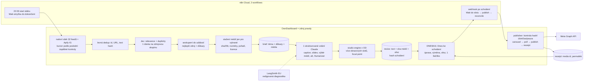

# DNESKAi Instagram: audit, doporučení a plán (20. 10. 2026)

Stav ověřený 20. 10. 2026 z kódu (own-dashboard `8095495`, quorum `9a9850f`, aifirst `2e6a4e0`), z n8n Cloud, Vercelu, Supabase a GitHub issues. Primární dokumentace (Meta, n8n, Apify, Vercel, Anthropic, Hostinger) čtená téhož dne. Nic se nenasazovalo, nespouštěl se žádný placený běh, nic se nepublikovalo. Prototypy v `dneskai-instagram-2026-10-20/` jsou návrhy, ne schválené publikace.

Co jsem neměl k dispozici: přihlášený prohlížeč (Chrome ani vestavěný prohlížeč nebyl v session dostupný), Apify connector (v session chybí), LangSmith (bez MCP), parametry plánu n8n Cloud a Supabase (MCP je nevrací), hodnoty produkčních tajemství (jen názvy).

## 1. Audit skutečného stavu

### 1.1 Co je kde

| Schopnost | V kódu | Na mainu | Nasazeno v produkci | Běží | Verdikt |
|---|---|---|---|---|---|
| Registr 42 zdrojů a rozvrh (`src/lib/marketing/dneskai-registry.ts`) | ano | ano | ano | ne (`403 collection-disabled`) | hotové, vypnuté |
| Sběr feedů přes podepsaný bridge do Quorum `/admin/api/marketing-collection` | ano | ano | ano (prod secret i URL) | ne | hotové, vypnuté, závislé na Quorum |
| Nativní sběr 32 feedů (`dneskai-native-feed.ts`, `free-feeds/`) | ano | **ne** (`codex/marketing-completion-audit`, 3 commity nad mainem, jen Vercel preview) | ne | ne | rozpracované, ověřen 1 feed z 32 |
| Instagram přes Apify (10 profilů, `apify~instagram-scraper`) | ano | ano | ano (token + actor v prod) | ne | hotové; poslední reálný běh 13. 10. |
| Jev klasifikace (kategorie, relevance, duplicity) | ano | ano (oprava z #109) | ano | ne | hotové; v produkčním běhu 0/4 výběr před opravou |
| Výběr témat (SQL v `marketing_dneskai_finish`) | ano | ano | ano | ne | hotové, nikdy nevybralo nic v produkci |
| Social návrh z vybraného tématu | **ne** | ne | ne | ne | **chybí**; kandidáti jsou slepá ulička |
| Social návrh z článku (`/admin/api/marketing-source`) | ano | ano | ano (secret, URL) | ne | hotové, ale článek od 25. 9. nevyšel |
| Generování (LangChain + ChatAnthropic, Humanizer) | ano | ano | **ne** (`ANTHROPIC_API_KEY`, `MARKETING_CLAUDE_*` jen na preview větvi) | ne | kód hotový, produkce bez klíče |
| Render (SVG → resvg → sharp, `templates/marketing/dneskai`) | ano | ano | ano | ne | jeden textový layout, 0 obrázků, šablona `approved:false` |
| Neměnné revize, hash schválení, fronta, idempotence | ano | ano | ano (migrace aplikované, 17 tabulek s RLS) | ne | hotové, 0 revizí, 0 publikací |
| Meta publisher (carousel, polling, reconciliation) | ano | ano | **ne** (Instagram tokeny jen na preview větvi; `marketing_accounts` prázdná) | ne | kód hotový, účet nepřipojený |
| LangSmith tracing (EU, redigovaný) | ano | ano | **ne** (klíče jen preview) | ne | hotové, vypnuté |
| n8n workflows | 11 exportů | ano | 11 workflows v Cloudu | **všech 11 neaktivních, 0 executions v historii** | nic neběží |
| Design Lab renderer (`quorum/studio`) | ano | ano | ano (boardless-ai.vercel.app) | ano (ruční kurátorství) | hotový, jeden obrazový slot na deck |
| Denní cyklus článků DNESKAi (`cycle.yml`) | ano | ano | ano | **ano, denně** | od 25. 9. nevyšel článek; 7× „no edition“ od 1. 10.; model utrácí ~0,40 $/den na články, které nikdo nevybere |

### 1.2 Staging po 15. 10. neuklizený

- Vercel: 55 proměnných na preview větvi `codex/marketing-automation` (Instagram tokeny obou značek, LangSmith, Anthropic, n8n secret, pilot tuple, šablonová schválení). V produkci jich je 15 a žádná nepatří publikování ani generování.
- n8n: credentials „marketing staging — expires 2026-10-15“ a „collection pilot — expires 2026-10-15“ stále existují, stejně jako „single production run 20261013“. Workflows `pilot worker`, `production verification`, `staging source check` jsou mrtvé jednorázovky.
- Supabase prod: 1 běh (13. 10., `partial`, 0 vybraných, 0,0172 $), 70 kandidátů (všech 70 `held`, z toho 10 bez data), 13 stavů zdrojů. Všechny feedy skončily `partial` s `last_success_at = null`, takže kurzor se nikdy neposune (odst. 7).
- Instagram média: kandidáti z `mosseri` a `meta.ai` nesou až 4 `mediaUrls` na post (carousel děti jsou zachycené), ale uložené CDN odkazy už vrací **403**. Nic je nestáhlo.
- Rezervace: tři generovací pokusy (0,75 $) a 0,04 $ Apify zůstávají zadržené; neresetovat.

### 1.3 Meta a účty

Produkce nemá žádný Instagram token. Preview větev nese `MARKETING_DNESKAI_INSTAGRAM_*` (stáří přes týden, platnost neověřitelná bez hodnoty). `marketing_accounts` je prázdná. Threads nemá nic. Takže publikování dnes není ani na dosah jednoho přepínače: nejdřív účet, token, ověřený řádek v `marketing_accounts`.

### 1.4 Rozdíl main vs. pracovní větev

`codex/marketing-completion-audit` (`2769e7b`) přidává nativní adaptéry s pinovaným TLS a DNS kontrolou, offline hodnocení Jev a novější dokumentaci Workflows. Testy prošly, ale živě byl porovnán jen `openai-blog`. Čtyři HTML zdroje (`anthropic-news`, `meta-ai`, `nieman-lab`, `tubefilter`) v nativní cestě vrací `reader-disabled`, protože placený reader je vypnutý. Větev je bezpečné sloučit (výchozí zůstává bridge), ale přepnutí na `native` potřebuje porovnání všech 32 feedů.

## 2. Mapa toku

### 2.1 Dnešní tok (co kód skutečně dělá)

```mermaid
flowchart LR
  subgraph n8n[n8n Cloud, vše neaktivní]
    C1[cron */5 22:00–23:55]
    P1[hourly publisher + webhook]
  end
  subgraph OD[OwnDashboard, Vercel + Supabase]
    COL[/api/marketing/dneskai/collect<br/>≤5 operací / 45 s tick]
    JEV[Jev 16 dávek]
    SEL[SQL výběr ≤4 témat]
    CAND[(marketing_dneskai_candidates<br/>70 held)]
    SRC[refreshMarketingSources<br/>vyžaduje kind=article]
    CAL[(kampaň + kalendářní slot)]
    GEN[LangChain + Claude<br/>Humanizer]
    REN[render.ts<br/>1 textový layout, 0 fotek]
    REV[(marketing_revisions<br/>hash schválení)]
    PUB[publisher.ts<br/>carousel → poll → publish]
  end
  subgraph Q[Quorum / BoardlessAI]
    BR[/admin/api/marketing-collection<br/>adaptéry RSS/HTML/API]
    AP[Apify instagram-scraper]
    CY[cycle.yml denně<br/>článek → 4 titulky + 4 obrázky]
    OWN[vlastník vybere článek]
    MS[/admin/api/marketing-source<br/>schválený článek + 1 hero]
  end
  C1 --> COL --> BR
  COL --> AP
  COL --> JEV --> SEL --> CAND
  CAND -. nic nenavazuje .-> SRC
  CY --> OWN --> MS --> SRC --> CAL --> GEN --> REN --> REV --> P1 --> PUB --> META[Meta Graph API]
```

Tři věci z toho plynou. Kandidáti končí v databázi a nic je nečte. Social návrh potřebuje schválený článek, článek potřebuje ruční výběr vlastníka v BoardlessAI a ten se od 25. 9. nestal. Každý krok je zvlášť správně napsaný, ale řetěz není spojený.

### 2.2 Doporučený tok



Odpovědnosti: n8n jen časuje a navazuje; OwnDashboard drží stav, schválení, joby a výsledky; modely dělají dvě ohraničené úlohy (Jev klasifikaci, Claude text + strukturu); renderer je deterministický kód bez modelu; storage je Supabase bucket `marketing-assets` (už existuje, privátní, JPEG, 8 MiB); Meta dostává podepsané URL a vrací receipt.

## 3. Vizuální rozbor reference

Reference je `@jsemvobraze` (Johana Bazlerová), post z 18. 10. 2026 „přehled toho, co vám mohlo uniknout“. Bez přihlášení jsem získal **jen první slide** (2160 × 2700 px, poměr 4:5); další slides jsou za přihlašovací zdí a opakované požadavky skončily 429. Rozbor tedy stojí na coveru a na veřejných náhledech dvou dalších carouselů téhož účtu (11. 10., 19. 10.). Zbytek slides si vyžádám jen tehdy, až bude blokovat šablony (odst. 11).

Co cover dělá:

- Skutečná fotografie přes celou plochu, barevná, s jednotným tónováním (oranžový filtr). Žádná ilustrace, žádný „AI“ vizuál.
- Jedno sdělení v tučném bezpatkovém písmu (vzhled SF/Inter), bílé na modrých „zvýrazňovačových“ pruzích. Diakritika správně.
- Druhý typografický hlas: ručně psaná poznámka „+ doporučení na články“ a tři samolepkové hvězdy. Osobní registr, ne redakční.
- Stálý podpis vpravo dole „Johana ✳ @jsemvobraze“.
- Fotka je osoba: tvář dává slide lidské měřítko. Druhé carousely stejného účtu mají stejný princip (selfie + krátký titulek vlevo nahoře, „shot on iPhone 18 Pro“ jako metadatum).

Co z toho vytváří dojem: fotka nese emoci, text nese jednu větu, barva je jedna sytá plus jedna kontrastní, a stejná kompozice se opakuje na každém coveru, takže profil působí jako série. Nejde o „pěkný design“, ale o disciplínu: jedna fotka, jedna věta, jeden podpis.

Co z toho přebíráme a co ne. DNESKAi je redakce, ne osoba, a brand kit (`quorum/studio/brand-kits/caught-up`) zakazuje emoji a samolepky. Přebíráme mechaniku: barevná fotka na celý cover, jedna věta v Space Grotesk 700 na tmavém scrimu nebo v barevném pruhu, pevný podpis (logotyp DNESKAi vlevo nahoře, zdroj a datum v IBM Plex Mono dole), stálá kompozice coveru. Druhý hlas nahradíme ne rukopisem, ale patkovým Source Serif 4 pro vysvětlující text a modrou linkou místo samolepek. Uvnitř carouselu střídáme čtyři typy slidů (fotka na celou plochu, obrázek v rámu s popiskem, půlený slide text + obrázek, jednobarevný výrok) a končíme slidem se zdroji a náhledy použitých obrázků. Prototypy p5 a p6 to ukazují.

## 4. Porovnání carousel řešení a doporučení

Objem: 2–4 příspěvky denně × 5–7 slides = **300–840 obrázků měsíčně**.

| Varianta | Co je dnes | Více fotek, čeština, přesný text | Úpravy a re-render | Cena / měsíc | Provoz, závislost | Přenositelnost |
|---|---|---|---|---|---|---|
| **A. Rozšířit Design Lab engine** (`@boardlessai/carousel-studio`) | Deterministický SVG → resvg → sharp, 30 rodin, kit DNESKAi s fonty Space Grotesk / Source Serif 4 / IBM Plex Mono, test pokrytí českých glyfů, golden hashe, běží na Vercelu v Quorum site (`serverExternalPackages`), ~0,2 s/slide (změřeno: 20 slides za 4,6 s včetně startu) | Čeština ano. **Více fotek ne**: schéma povoluje jeden obrazový slot na šablonu (`studio/src/schema.ts:324-326`, `slot: literal("image")`), bez focal pointu (`xMidYMid slice`), launch rodiny fotku převádí do mono | Text a recipe se přehrávají deterministicky; výměna obrázku jen přes Queue mezi ≤4 kandidáty; ořez neexistuje | 0 $ (Vercel compute ≈ 0,05 $/měs. na Pro) | žádná nová služba, balíček je samostatný (`studio/src` nic neimportuje mimo sebe), nutné přenést `fonts/` a `brand-kits/` | plně náš kód |
| **B. Vlastní malý renderer** | OwnDashboard má vlastní `render.ts` (stejný stack, 1 layout, 0 obrázků, šablona z Claude Design `approved:false`) | HTML/CSS + Chromium: na Vercelu jen `puppeteer-core`/`playwright-core` + `@sparticuz/chromium-min` (250 MB limit, brotli balík mimo bundle, studené starty). Satori/`@vercel/og`: limit 500 kB bundle, fonty i fotky za běhu, žádné měření textu | Vše od nuly: fit textu, zalamování, kit, testy | 0 $ | druhý renderer vedle studia = dvě pravdy | náš kód |
| **C. Služba s API** | Templated.io (29 $/měs. ročně, 1 000 renderů, sync ~2 s, vícestránková šablona vrací pole), Bannerbear (49 $, 1 000 kreditů), Placid (~19 $ neověřeno, 500 kreditů), Abyssale (45 $, 450 kreditů), Switchboard (19 $, 1 000 volání), Canva Connect (autofill + export, Pro plán, async joby, URL platné 24 h, veřejná integrace podléhá review), Figma REST (jen export, bez zápisu textu) | Fonty nahrát lze, čeština nedoložená, nikdo nemá „carousel“ objekt | Každá úprava = nový placený render | 19–49 $/měs. + lock-in | šablony se neexportují, retence dat většinou neuvedená | žádná |

Prototypy to potvrzují. p1–p4 jsou výstup dnešního studia: čeština, typografie a kit sedí, ale fotka je jedna, mono, oříznutá středem, a tři ze šesti slidů jsou jen barevné textové karty s číslem, přesně to, co nechceš. p5 a p6 jsou stejný stack s více sloty, barevnou fotkou, focal pointem, obrázkem v rámu a slidem se zdroji; vyrenderované za 1,3 s na 7 slidů.

**Doporučení: varianta A.** Rozšířit schéma studia o obrazové sloty per slide a pět fotografických typů slidů, zrušit vynucené mono pro DNESKAi, ořez a focal point pálit do bytů před renderem (sharp `extract`), a balíček spotřebovávat v OwnDashboardu místo jeho vlastního `render.ts`. Důvod: je to jediná cesta, která už má změřené české fonty, kit, golden testy a doložený běh na Vercelu, stojí 0 $ navíc, nepřidává dodavatele a nevede ke dvěma rendererům. Varianta C by za 19–49 $ měsíčně koupila méně než dnes umíme. Varianta B má smysl jen pro Chromium efekty (blur, maskování, CSS grid), které DNESKAi nepotřebuje.

Co se v OwnDashboardu zahodí: `templates/marketing/dneskai/derived-layout.json` a jednolayoutový `render.ts:131-218`; zůstane `renderMarketingAssets` (klíče, hash, upload do bucketu, podepsané URL).

## 5. Práce s více zdrojovými obrázky

### 5.1 Datový model

Nová tabulka `marketing_media_assets` (RLS own-only, stejně jako ostatní):

| Sloupec | Význam |
|---|---|
| `id` uuid | identita záznamu |
| `sha256` text, unique per user | **identita média** = hash bytů; stejný obrázek ze dvou zdrojů je jeden asset |
| `candidate_id`, `source_id`, `external_id` | ke které položce patří |
| `origin_url`, `origin_kind` (`instagram-child`, `instagram-display`, `og-image`, `article-figure`, `press-kit`) | odkud a jak |
| `position` int | pořadí v původním carouselu nebo článku |
| `width`, `height`, `mime`, `bytes` | pro gate rozlišení (odst. 5.3) |
| `storage_path` | `marketing-media/<user>/<sha256>.jpg|png` v bucketu `marketing-assets` |
| `rights_class` (`publisher-own`, `source-account`, `press`, `wire-stock-flagged`, `unknown`), `rights_note`, `credit` | podklad pro oprávněné použití a popisek |
| `fetched_at`, `origin_expires_hint` | kdy jsme stáhli; IG CDN vyprší za 24–48 h |
| `phash` text | pro odstranění vizuálních duplicit |

Revize (`ContentRevision`, `src/lib/marketing/contracts.ts:74-90`) dostane `media: [{ slide, slot, assetSha256, crop: { fx, fy, zoom }, fit }]`. Hash schválení (`hashes.ts`) kryje `assetSha256 + crop + text + účet + čas`, **ne** doručovací URL. Podepsaný URL (`asset-urls.ts`) se smí obnovit beze změny hashe, protože byty jsou ověřené proti sha256 před každým použitím; to je přesně oddělení identity média od dočasného odkazu, které jsi žádal. Dnes je `assets[].url` součástí hashe, takže obnova URL vynutí nový souhlas; to změníme.

### 5.2 Získání

1. **Levně při sběru**: text, metadata, `mediaUrls` (Instagram už to dělá, cap 4 → zvýšit na 10, protože carousely mívají 10 dětí), u feedů jen `url`. Nic se nestahuje.
2. **Při výběru tématu**: pro každou vybranou událost stáhnout stránku primárního zdroje jednou a vytáhnout `og:image` + obrázky v těle článku (`<figure>`, obrázky z vlastní domény vydavatele). Pro IG položky stáhnout všechny `mediaUrls` ihned (CDN expiruje). Vše uložit do bucketu pod sha256.
3. **Dedup**: sha256 (bitově stejné) + pHash (stejná fotka v jiném rozlišení nebo ořezu, typicky `displayUrl` vs. `images[0]`).
4. **Ořez a focal point**: výchozí střed; vlastník klikne do náhledu a nastaví `fx, fy`; render pálí `extract` přes sharp podle cílového slotu. Uloženo v revizi, ne v assetu.
5. **Pořadí**: uchovat `position` z původního carouselu; model smí vybrat podmnožinu a pořadí změnit, UI ukáže původní pořadí v zásobníku média tématu.
6. **Re-render**: klíč renderu = `sha256(templateSha, slidePayload, assetSha, crop)`; nezměněný slide se nerenderuje znovu, protože výsledný JPEG už leží v bucketu pod tímto klíčem.

### 5.3 Kontrola úplnosti obrazového carouselu

Před generováním textu (ne po něm, aby model nevymýšlel slides k obrázkům, které nemáme):

- carousel typu „obrazový“ vyžaduje ≥ 1 asset s kratší stranou ≥ 900 px (cover na celou plochu) a celkem ≥ 2 použitelné assety; obrázek v rámu stačí od 600 px (prototyp p5 ukazuje štítek rozlišení u 624 px figur z Hugging Face: použitelné v rámu, ne na cover);
- `rights_class = wire-stock-flagged` (Getty, Reuters, AP, Shutterstock v URL nebo v creditu) obrázek vyřadí; typický případ je TechCrunch `og:image` z Getty (prototyp p3 proto běží v textové rodině);
- když podmínky nesplní, téma nespadne: dostane typ „textový carousel“ nebo „oznámení“ (jeden obrázek nebo typografický slide) a v UI stav **„bez použitelného obrázku“**. Nikdy tiše nenahradit generovanou ilustrací.
- popisek Reelu zůstává popiskem: `origin_kind` a text kandidáta nesou „caption“, ne „transcript“; prompt to dostane jako pole `captionOnly: true`.

## 6. DNESKAi rozhraní v OwnDashboardu

Existující projekt DNESKAi (`project-workspace.tsx:233`, záložka Zdroje) rozšířit o záložky:

| Záložka | Obsah | Zdroj dat |
|---|---|---|
| **Dnes ke schválení** | karty připravených příspěvků pro zítřek, každá s pásem slidů, stavem a jedním tlačítkem | `marketing_revisions` status `review` pro brand dneskai |
| **Kalendář** | 7 dní, sloty, co je schválené/naplánované/publikované, DST 25. 10. správně | `marketing_publications.scheduled_at` v Europe/Prague |
| **Zdroje** | dnešní záložka: zdroje, poslední úspěšná kontrola, částečné výsledky, důvody zadržení | už existuje (`/api/marketing/dneskai/sources`) |
| **Publikované** | receipt: permalink, čas, účet, náhled, odkaz na revizi | `marketing_publications` `published` |
| **Chyby a náklady** | zadržené běhy, nejasné výsledky, cena za den (Apify, Jev, Claude), rezervace | `marketing_dneskai_runs.cost_usd`, `marketing_jobs.result.usage`, `job-health` |

Detail příspěvku (jedna obrazovka, bez technických polí v hlavním toku):

- vlevo pás všech slidů ve skutečném renderu, aktuální verze; klik otevře slide;
- u slidu: text (headline, body) s počítadlem znaků z `reviewPostSlides`, obrázek s focal pointem (klik do náhledu), tlačítka „vyměnit“ (zásobník médií tématu s původním pořadím a creditem), „odebrat slide“, „posunout“;
- vpravo caption, zdroje s odkazy, účet, plánovaný čas (výchozí z kalendáře, upravitelný), alt texty sbalené;
- po každé změně se re-renderují jen dotčené slidy a vznikne nová revize `replaces_id` (dnes už tak funguje `edit`); hash v tlačítku se obnoví;
- **jedno hlavní tlačítko „Schválit a zařadit“** = `marketing_approve_revision(id, hash)`; vedle sekundární „Vrátit k úpravě“ a „Přeskočit“;
- „Podrobnosti“ sbalené: trace id, template sha, asset sha, job id.

Stavy, které UI rozlišuje barvou i textem: připravuje se (`marketing_jobs` running) · čeká na kontrolu (`review`) · vráceno (`returned`) · schváleno (`approved`) · naplánováno (`publications.queued` s časem) · publikováno (`published` + permalink) · chyba nebo nejasný výsledek (`failed`, `reconciliation`, s textem co se stalo a co se dělá dál). Dnešní `marketing-panel.tsx` už umí schválení s hashem, holdy a job health; chybí pás slidů, editor obrázků a záložky.

## 7. Odstraněné mezikroky a vyčíslené úspory

| Mezikrok | Dnes | Po změně | Úspora, doloženo |
|---|---|---|---|
| Social čeká na schválený článek z BoardlessAI | povinné (`source-refresh.ts:145`, `kind==='article'`) | brief z vybraného tématu, článek je volitelný další výstup | odblokuje celý tok; články od 25. 9. nevyšly |
| Denní cyklus článků | běží, ~0,40–0,45 $/pokus (`cost-report.json`: cu-edition 21 cyklů, 6,02 $ MTD), vlastník nevybral | pozastavit cu-edition/cu-product, ponechat streams a events | **≈ 8–12 $/měs.** modelu bez jediného publikovaného článku |
| Sběr feedů přes Quorum bridge | 2 nasazení, HMAC, 50 s route, dvojí registr | nativní adaptéry v OD (větev už existuje) | méně předávání; API ceny se nemění |
| n8n cron `*/5 22-23` | 24 executions/den = **720/měs.** i když běh skončí za 10 minut | 1 execution/den s Wait-smyčkou (Wait neúčtuje další execution podle definice „jeden běh celého workflow“) | **≈ 690 executions/měs.**; Starter má 2 500 |
| Hourly publisher recovery | 24 executions/den naprázdno | webhook po schválení + Wait do slotu; recovery 1× denně | ≈ 700 executions/měs. |
| 16 pevných Jev dávek na běh | `__jev:00..15` vždy | dávka na skupinu zdrojů, jen pokud jsou nové kandidáty | Jev je levný (0,001 $/běh), úspora je v krocích, ne v penězích |
| Kampaň + kalendářní slot jako podmínka jobu | `orchestrator.ts:37-57` | brief vytvoří slot sám (výchozí časy z registru) | ruší import 139řádkového plánu z GitHubu |
| Ukládání provozu přes Git commity | aifirst: 22 stream + 18 events commitů od 1. 10.; Quorum commituje runtime cesty denně | social: jen DB; streams/events ponechat (jsou produkt webu) | 0 nových commitů za social provoz |
| CI/build po každé obsahové změně | Quorum post-cycle gate 11 min 22 s denně (z #104, GitHub runner, zdarma pro veřejné repo) | social nespouští Actions vůbec | čas, ne peníze |
| Opakované rendery nezměněných slidů | každý edit renderuje všechny slidy | klíč renderu z hashů (odst. 5.2) | ~0,2 s/slide, na Vercelu zanedbatelné |
| Opakované stahování médií | nic se nestahuje, URL expirují | stáhnout jednou při výběru, uložit pod sha256 | odstraní 403 u IG médií |
| Apify Starter 22,99 $/měs. (`quorum/config/fixed-costs.json`) | kredit 19 $ nevyužit: cyklus má `APIFY_TOKEN: ""`, Reel scraper (#95) odložen, DNESKAi běh stál 0,016 $ | po pilotu zvážit Free plán (5 $ kreditu) | **až 23 $/měs.** (rozhodnutí 11.6) |

Náklad modelu na příspěvek (ceny 20. 10. 2026, platform.claude.com): Sonnet 5.5 2 $/10 $ za MTok, odhad 3 000 vstup + 1 500 výstup = **0,021 $**; Haiku 5.5 0,10 $/0,50 $ = **0,001 $**. Jev 0,042 $/MTok vstup, výstup zdarma; produkční běh stál 0,0011 $. Apify `instagram-scraper` 2,30 $/1 000 výsledků na Starteru; 4 profily denně × 7 položek ≈ 0,02 $/den.

## 8. Hosting

| | A. Současné služby | B. VPS jen pro renderer/worker | C. Self-hosting n8n + worker |
|---|---|---|---|
| Co | Vercel (OD) + Supabase + n8n Cloud | A + Hostinger KVM 2 (8,79 $ promo na 24 měsíců, 14,99 $ obnova) | KVM 2 s n8n Docker šablonou, OD dál na Vercelu |
| Render | ~0,2 s/slide ve Vercel funkci, do 300 s na Hobby | stejné, jen jinde | stejné |
| Měsíčně (2 posty/den) | API ≈ 1,5–2,5 $ (Sonnet) nebo 0,1 $ (Haiku) + n8n Starter 20 €/měs. ročně (po trialu) + Vercel 0 $ (Hobby) + Supabase 0 $ (pod 1 GB) | A + 8,79–14,99 $ + zálohy + aktualizace | 8,79–14,99 $ místo n8n Starter, ale TLS, zálohy, upgrady, monitoring na tobě |
| Měsíčně (4 posty/den) | API ≈ 3–5 $ (Sonnet) | + VPS | + VPS |
| Jednorázově | 0 | 2–4 h provisioning + deploy pipeline | 1–2 dny + průběžně ~1 h/měs. |

Rozhodnutí: **VPS teď nepotřebujeme.** Render je pod sekundou na slide bez prohlížeče, Vercel ho zvládá v existující funkci (Quorum to tak provozuje), storage je pod 1 GB. Jediná reálná otázka je n8n: trial je omezen na 14 dní / 1 000 executions (z #98), Starter stojí 20 €/měs. ročně. Pokud nechceš Starter, levnější náhrada není VPS, ale **pg_cron + pg_net v Supabase**, které zavolá tick endpoint OD každých 5 minut zdarma a bez executions; n8n pak zůstane jen pro notifikaci a ruční spuštění. Hostinger VPS má smysl jen tehdy, až by sem přibylo Chromium nebo video. Nic nekupovat.

Vercel Hobby je pro osobní nekomerční užití a cron má jen denní granularitu s rozptylem 59 minut; to stačí pro 22:00 start, ne pro minutové publikování. Proto publikování časuje n8n Wait (nebo pg_cron), ne Vercel cron.

## 9. Implementační plán podle závislostí

Značky: **[úprava]** existujícího kódu · **[konfigurace]** · **[nový modul]** · **[rozhodnutí]** vlastníka. Odhad je čistý inženýrský čas.

| # | Krok | Typ | Závisí na | Odhad |
|---|---|---|---|---|
| 0 | Rozhodnutí z odst. 11 | [rozhodnutí] | | |
| 1 | Úklid stagingu: smazat preview proměnné větve `codex/marketing-automation`, dvě expirované n8n credentials, archivovat `pilot worker`, `production verification`, `staging source check`, `daily preparation`, `source reconciliation`; ponechat exporty v repu jako historii | [konfigurace] | 0 | 1 h (vlastník + agent) |
| 2 | Sloučit `codex/marketing-completion-audit` do mainu (rebase, bridge zůstává výchozí); read-only porovnání všech 32 feedů native vs. bridge; přepnout `MARKETING_DNESKAI_FEED_PROVIDER=native`; 4 HTML zdroje buď nativní HTML adaptér bez readeru, nebo dočasně ponechat přes bridge | [úprava] + [konfigurace] | 1 | 1 den |
| 3 | Kurzor sběru: `partial` kvůli `item-cap` nastaví `last_success_at` (dnes nikdy, `20261013165236…sql:118`); `maxItems` u denních feedů 10 → 20; `mediaUrls` cap 4 → 10 | [úprava] migrace + `dneskai-providers.ts` | 2 | 0,5 dne |
| 4 | Pozastavit články: `config/ventures.json` caught-up `status: paused` zastaví cu-edition/cu-product před voláním (`cycle.ts:320-335`); ověřit dry během, že streams/events dál synchronizují a že `delivery -- reviewed` nic nepíše; `DNESKAI_COLLECTION_ENABLED` v Quorum ponechat jen do kroku 2 | [úprava] + [rozhodnutí] | 0 | 0,5 dne |
| 5 | Média: tabulka `marketing_media_assets`, stahovač (jen pro vybrané), pHash, gate rozlišení a práv, bucket cesta; IG média stáhnout ihned při sběru vybraných | [nový modul] | 3 | 2 dny |
| 6 | Události a brief: seskupení kandidátů (Jev `duplicateOf` + normalizovaná shoda titulků + stejná primární URL), výběr nejlepšího zdroje, důkazy = ostatní URL; `SourcePacket kind: 'brief'` s `evidence[]` a `media[]`; `parseSourcePacket` povolí brief pro dneskai; `refreshSource` pro brief čte lokální producer místo bridge | [nový modul] + [úprava `contracts.ts`, `source-refresh.ts`, `orchestrator.ts`] | 3, 5 | 2 dny |
| 7 | Admise bez kampaně: brief vytvoří kalendářní slot (výchozí 08:00 a 17:00 Praha) a job; `weekly-planning.ts` dneskai `['brief','article']` | [úprava] | 6 | 0,5 dne |
| 8 | Generování v5: jedno strukturované volání vrací caption, 4–8 slidů s typem (`cover-photo`, `figure`, `split`, `statement`, `sources`), výběr `assetSha256` per slide z nabídky, alt texty; Humanizer zůstává v témže volání (`humanizer.ts`); validace: čísla jen ze zdrojů, assety jen z nabídky, caption ≤ 2 200, hashtagy ≤ 30; model `claude-sonnet-5-5` pro pilot, Haiku 5.5 pro A/B po evaluaci | [úprava `generation.ts`] | 6 | 1,5 dne |
| 9 | Renderer: ve studiu schéma `carousel-template/2` (obrazové sloty `image-1..n` per slide, `focal` v payloadu, `treatment` volitelné), pět fotografických slide typů pro kit caught-up, golden testy; v OD vendorovat `studio/dist` + `fonts/` + `brand-kits/caught-up` jako `packages/carousel-studio` (git subtree) a nahradit layout v `render.ts`, ponechat upload/hash | [nový modul] ve studiu + [úprava] v OD | 5 | 3 dny |
| 10 | Revize a hash: `media[]` v `ContentRevision`, hash přes sha assetu + ořez místo URL; obnova podepsané URL bez nové revize; render cache podle hashů | [úprava `contracts.ts`, `hashes.ts`, `asset-urls.ts`, migrace] | 9 | 1 den |
| 11 | UI DNESKAi: záložky, karta příspěvku, pás slidů, editor textu, výměna a ořez obrázku, jedno tlačítko; EN/CS; mobil; axe | [nový modul] + [úprava `marketing-panel.tsx`] | 10 | 3 dny |
| 12 | n8n: dvě workflows (22:00 start s Wait-smyčkou do `continue=false`; publisher: webhook po schválení → Wait do `scheduled_at` → `publish` → `reconcile`), smazat `*/5` cron a hourly recovery; `MARKETING_N8N_SECRET` v produkci; alternativně pg_cron tick | [konfigurace] + [úprava `workflows/marketing/*.json`] | 7 | 0,5 dne |
| 13 | Meta: Business app v Development módu, Instagram Login, `instagram_business_basic` + `instagram_business_content_publish`, vlastník jako role user, long-lived token (60 dní) do produkčního env, job obnovy tokenu každých 50 dní, řádek `marketing_accounts` s `verified_at`; `MARKETING_APPROVED_ASSET_HOSTS` = Supabase storage host | [konfigurace] vlastník + [úprava] job obnovy | 0 | 2 h + 0,5 dne |
| 14 | LangSmith: `MARKETING_LANGSMITH_ENABLED` + EU klíč v produkci jen pro generaci; `recordOwnerFeedback` navázat na úpravy v UI (diff text před/po = evaluační příklad) | [konfigurace] + [úprava] | 8, 11 | 0,5 dne |
| 15 | Jev: ponechat; 1 dávka na zdrojovou skupinu; přidat „event cluster“ otázku jen pokud krok 6 nestačí; offline evaluace z větve pustit nad daty z kroku 2 | [úprava] | 2 | 0,5 dne |
| 16 | Pilot (odst. 10) | | 1–15 | 1 den |
| 17 | Threads později: samostatný app use-case, `threads_basic` + `threads_content_publish`, vlastní token, stejný publisher (`format: 'thread'` už existuje) | [konfigurace] | po pilotu | 0,5 dne |

Celkem ≈ 17–19 inženýrských dní bez čekání na rozhodnutí a účty. Kroky 2, 3, 4 a 13 lze dělat souběžně hned.

K LangChain a CLI: generace zůstává v serverové službě OD (LangChain + `ChatAnthropic`), kde je rozpočtová rezervace a tracing. LangSmith MCP v CLI má smysl jen pro čtení trace a zakládání evaluačních datasetů z terminálu; do produkční cesty ho nepotřebujeme. Pokud ho nastavíš, přidám do kroku 14 skript, který z úprav v UI vytvoří dataset „owner-edits“.

## 10. Plán jednoho ověřovacího pilotu

Cíl: jeden skutečný příspěvek z jednoho skutečného zdroje, s více obrázky, upravený a schválený v OwnDashboardu, publikovaný přes API s receiptem. Rozsah předem schválený, žádné další dílčí souhlasy.

| Krok | Co se stane | Důkaz |
|---|---|---|
| 1 | Sběr pro jeden den v produkci: registr podle dne, nativní feedy + Apify pro due profily; cap 0,10 $ | `marketing_dneskai_runs` řádek, cena |
| 2 | Jev + seskupení: ≥ 1 událost s ≥ 3 použitelnými obrázky (typicky IG carousel od `mosseri` nebo blog s vlastními figurami) | brief s `media[]` |
| 3 | Jedno generování (max 3 pokusy, ≤ 0,25 $), render všech slidů | revize `review`, trace v LangSmith EU |
| 4 | Vlastník: upraví text jednoho slidu, vymění jeden obrázek, posune focal point, změní čas | nová revize `replaces_id`, hash se změnil |
| 5 | Schválení přesné verze | `approved_hash = content_hash`, publication `queued` |
| 6 | Publikace ve slotu do 24 h (kontejnery expirují po 24 h), dry-run vypnutý jen pro tento brand a účet | `marketing_publications.published`, `remote_media_id`, `remote_url` |
| 7 | Reconcile: GET `/{ig-user-id}/media` potvrdí id; UI ukáže permalink | receipt v záložce Publikované |

Rozpočet pilotu: **≤ 1,50 $ celkem** (Apify ≤ 0,10 $, Jev ≤ 0,01 $, Claude ≤ 0,25 $ × 3 pokusy, rezerva). Nepoužívat staré rezervace. Přepínače: `MARKETING_PUBLISH_ENABLED=true` + `MARKETING_DNESKAI_PUBLISH_ENABLED=true` jen po dobu pilotu, `marketing_accounts.enabled=true` jen pro `@dneskai`. Rollback: oba přepínače zpět, workflow unpublish. Timeout při `media_publish` není neúspěch: publikace jde do `reconciliation`, nikdy druhý POST (`publisher.ts:184-206` to už dělá).

Kritéria úspěchu: receipt existuje a shoduje se s GET; schválený hash odpovídá publikovaným bytům (sha assetů); žádné duplicitní publikace; náklady doložené v záložce Chyby a náklady; celý den (sběr → schválení) proběhl s ≤ 3 n8n executions.

## 11. Rozhodnutí pro vlastníka

1. **Článek pozastavit** nastavením caught-up `status: paused` v Quorum (streams a events jedou dál). Ušetří ≈ 8–12 $/měs. modelu za nevybrané články. Ano/ne.
2. **Renderer**: rozšířit studio engine (varianta A) a spotřebovávat ho v OwnDashboardu; zahodit jednolayoutový `render.ts` a Claude Design šablonu `dneskai-editorial/2`. Ano/ne.
3. **Zdroj feedů**: sloučit větev s nativními adaptéry a po porovnání 32 feedů přepnout na `native`; Quorum bridge vypnout až potom. Ano/ne.
4. **Časování**: n8n Cloud Starter (20 €/měs. ročně) se dvěma workflows, nebo pg_cron v Supabase zdarma a n8n jen pro notifikace. Potvrď aktuální plán n8n (trial / Starter) v administraci, MCP ho nevrací.
5. **Model pro text**: Sonnet 5.5 pro pilot (≈ 0,02 $/post), Haiku 5.5 jako kandidát po evaluaci. Ano/ne.
6. **Apify**: po pilotu zvážit přechod ze Starteru (22,99 $/měs.) na Free (5 $ kreditu), pokud nic jiného Apify nepoužívá. Rozhodnout až s čísly z pilotu.
7. **Práva k obrázkům**: potvrdit pravidlo, že se používají jen média vydavatele zdroje nebo sledovaného účtu s uvedeným creditem a bez wire/stock fotek; IG média cizích účtů jen u doložených spoluautorství nebo s creditem „Foto: @účet“. Toto je editorská, ne technická otázka.
8. **Reference**: pokud chceš, aby šablony vycházely i z vnitřních slidů `@jsemvobraze`, pošli screenshoty slidů 2–N; cover stačí pro cover.
9. **Úklid stagingu** (krok 1) můžu provést sám po tvém „ano“; mazání proměnných a credentials je nevratné.
10. **Pilot** v rozsahu a rozpočtu z odst. 10. Ano/ne, a který den.

## Přílohy

- `dneskai-instagram-2026-10-20/p5-beam-multi-sheet.jpg`, `p6-lightroom-multi-sheet.jpg`: cílový stav (více obrázků, focal point, slide se zdroji), stejný stack jako studio.
- `p1-lightroom-vista-sheet.jpg`, `p2-beam-press-sheet.jpg`, `p3-deepseek-fault-sheet.jpg`, `p4-spotify-single-sheet.jpg`: dnešní studio engine beze změn (1 obrazový slot, mono, textové karty; p3 ukazuje stav „bez použitelného obrázku“, p4 je single-image oznámení).
- Zdrojové obrázky prototypů: Adobe (přes The Verge, 20. 10. 2026) a Hugging Face / Reflection AI (16. 10. 2026). Texty jsou české návrhy sestavené z uvedených článků, nejsou redakčně schválené.
- Primární dokumentace čtená 20. 10. 2026: developers.facebook.com (Instagram Platform content publishing, IG Login, app modes, Threads), n8n.io/pricing a docs (Wait, sub-workflows), apify.com (pricing, instagram-scraper), vercel.com/docs (functions limitations, cron, OG, Blob), platform.claude.com/docs (pricing), typesafe.ai, hostinger.com (VPS, n8n hosting), templated.io, bannerbear.com, placid.app, abyssale.com, canva.dev (Connect API).
